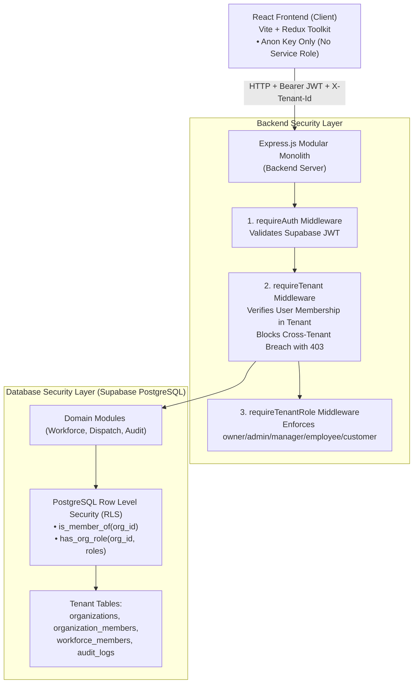

# OpsPilot — Multi-Tenant Enterprise Operations & Workforce Management SaaS

OpsPilot is a modern, enterprise-grade Operations & Workforce Management SaaS built with a **Modular Monolith** architecture. It enforces strict **organization-level isolation** across both the backend application layer and PostgreSQL database level via Row Level Security (RLS).

---

## 🛠️ Technology Stack

| Layer                 | Technologies                                                                                     |
| --------------------- | ------------------------------------------------------------------------------------------------ |
| **Frontend**          | React 19, Vite 6, JavaScript (ES2024), Tailwind CSS, Redux Toolkit, React Router 7, Lucide Icons |
| **Backend**           | Node.js (v24), Express.js (Modular Monolith), Helmet, CORS, Morgan, Zod                          |
| **Database & Auth**   | Supabase PostgreSQL 15+, Supabase Auth (GoTrue), Supabase Storage, Row Level Security (RLS)      |
| **Quality & Tooling** | ESLint 9 (Flat Config), Prettier, Node.js Native Test Runner (`node:test`), Supertest            |

---

## 🔒 Security & Tenant Isolation Architecture

OpsPilot enforces defense-in-depth tenant isolation across **two independent boundaries**:



### 1. Backend Application Layer Isolation (`tenantMiddleware.js`)

- Requires the `X-Tenant-Id` HTTP header on all tenant-scoped API requests.
- Validates that the tenant exists and is active.
- Verifies that the authenticated user (`req.user.id`) has an **active membership** in that specific organization.
- Rejects any unauthorized cross-tenant attempt immediately with `403 Forbidden` (`FORBIDDEN_CROSS_TENANT_ACCESS`).

### 2. Database Layer Isolation (`002_rls_policies.sql`)

- PostgreSQL Row Level Security (RLS) enabled on all tables: `organizations`, `organization_members`, `workforce_members`, `audit_logs`, `storage.objects`.
- Direct database queries enforce `is_member_of(organization_id)` and `has_org_role(organization_id, roles)`.
- Even in case of application error, the database engine prohibits rows from leaking across tenants.

### 3. Service-Role Credential Guard

- The frontend client strictly uses `VITE_SUPABASE_ANON_KEY`.
- `SUPABASE_SERVICE_ROLE_KEY` is exclusively loaded on the Express backend and is protected by runtime security assertions preventing any frontend bundling.

---

## 📁 Repository Structure

```
OpsPilot/
├── client/                      # React 19 + Vite 6 Frontend SPA
│   ├── src/
│   │   ├── components/          # Reusable UI & TenantBadge
│   │   ├── layouts/             # AppLayout, Navbar, Sidebar
│   │   ├── pages/               # Dashboard, Workforce, Organizations, Login
│   │   ├── routes/              # ProtectedRoute, AppRoutes
│   │   ├── services/            # apiClient (X-Tenant-Id), supabaseClient (Anon only)
│   │   └── store/               # Redux Toolkit (authSlice, tenantSlice, uiSlice)
│   ├── package.json
│   ├── tailwind.config.js
│   └── vite.config.js
├── server/                      # Node.js + Express.js Modular Monolith
│   ├── src/
│   │   ├── config/              # env.js, supabase.js (admin client)
│   │   ├── database/            # migrate.js
│   │   ├── middleware/          # authMiddleware, tenantMiddleware, errorMiddleware
│   │   ├── modules/             # Modular domains (health, auth, organizations, workforce)
│   │   ├── tests/               # Backend unit and security tests
│   │   ├── app.js
│   │   └── server.js
│   └── package.json
├── database/                    # Database DDL, Migrations & Seeds
│   ├── migrations/              # SQL DDL migrations with RLS policies
│   ├── seeds/                   # Seed data for local & staging environments
│   └── schema.sql               # Consolidated schema reference
├── docs/                        # System Documentation & Specifications
│   ├── PRD.md                   # Complete Product Requirement Document
│   ├── PRD-REVIEW.md            # 16-Criteria PRD Review & Gap Analysis
│   ├── ARCHITECTURE.md          # Complete System Architecture Blueprint
│   └── FEATURE-INVENTORY.md     # Feature Inventory & Topological Build Order
├── tests/                       # Monorepo Integration & E2E Tests
│   └── integration/             # Health and cross-tenant boundary security tests
├── scripts/                     # Operational & Development Utilities
│   ├── dev.js                   # Concurrent dev server launcher
│   └── check-env.js             # Environment & credential security health check
├── .env.example                 # Root environment variables template
├── eslint.config.js             # ESLint 9 Flat Configuration
├── .prettierrc                  # Prettier formatting standards
├── .gitignore                   # Version control ignore rules
└── package.json                 # Monorepo root workspace configuration
```

---

## 🚀 Quickstart & Development Commands

### 1. Install Monorepo Dependencies

```bash
npm run install:all
```

### 2. Verify Environment & Credential Safety

```bash
npm run check:env
```

### 3. Run Quality Checks (Linting & Formatting)

```bash
npm run lint          # Run ESLint (Flat Config)
npm run format:check  # Check Prettier code formatting
npm run format        # Auto-format all code
```

### 4. Execute Automated Test Suites (Unit & Integration)

```bash
npm test              # Runs backend unit tests & cross-tenant security integration tests
```

### 5. Launch Local Development Environment (Concurrent Client + Server)

```bash
npm run dev           # Spawns Express API (port 5000) & Vite React App (port 5173)
```

Alternatively, run services individually:

```bash
npm run dev:server    # Express API on http://localhost:5000 (Health: /api/health)
npm run dev:client    # Vite React App on http://localhost:5173
```

### 6. Production Frontend Build

```bash
npm run build
```

---

## 🗺️ Project Milestones

- [x] **Milestone 1: Professional Project Setup, Modular Monolith & Multi-Tenant Core**
  - Database schema & RLS policies for multi-tenancy (`organizations`, `organization_members`, `workforce_members`, `audit_logs`).
  - Node.js/Express modular monolith with `requireAuth` and `requireTenant` isolation middleware.
  - Automated security test suite confirming cross-tenant access rejection and data isolation.
  - React + Vite + Tailwind CSS + Redux Toolkit application with Navbar, Sidebar, Tenant Switcher, Dashboard, and Workforce Directory.
- [ ] **Milestone 2: Authentication & Tenant Onboarding Flow**
- [ ] **Milestone 3: Enterprise RBAC & Member Management**
- [ ] **Milestone 4: Workforce & Operations Management Module**
- [ ] **Milestone 5: Operations Dispatch & Asset Tracking**
- [ ] **Milestone 6: Document & Media Management via Supabase Storage**
- [ ] **Milestone 7: Analytics, Audit Trails, Real-time Dashboard & Reporting**
- [ ] **Milestone 8: Production Hardening, E2E Testing Suite & Docker DevOps CI/CD**
