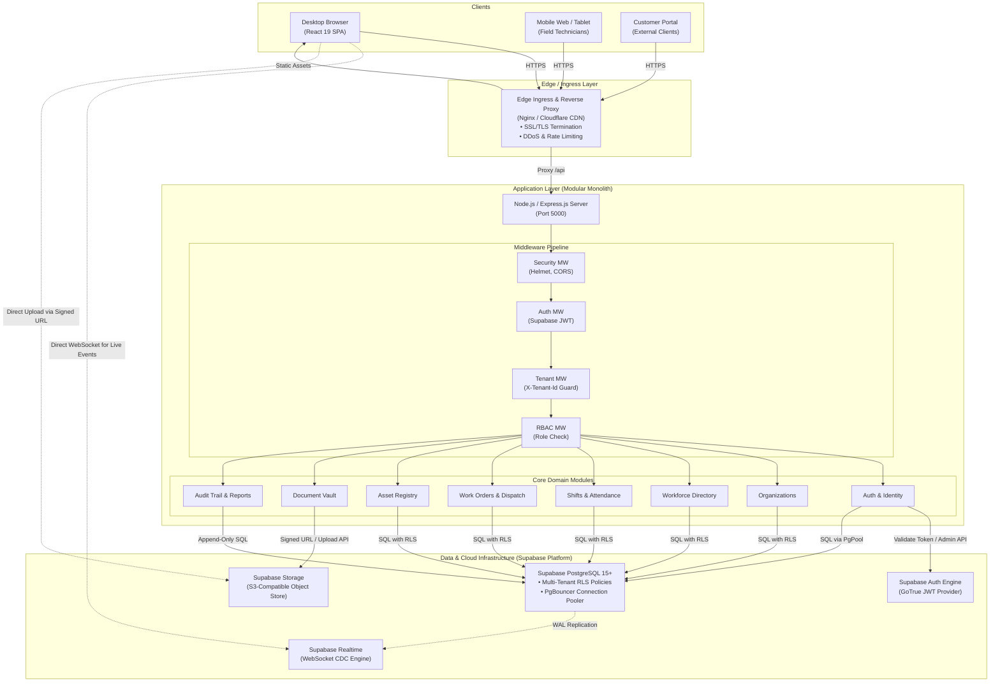
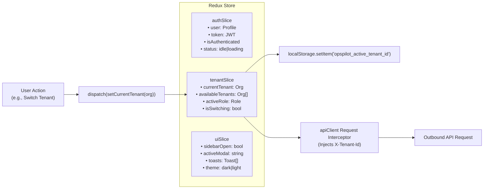
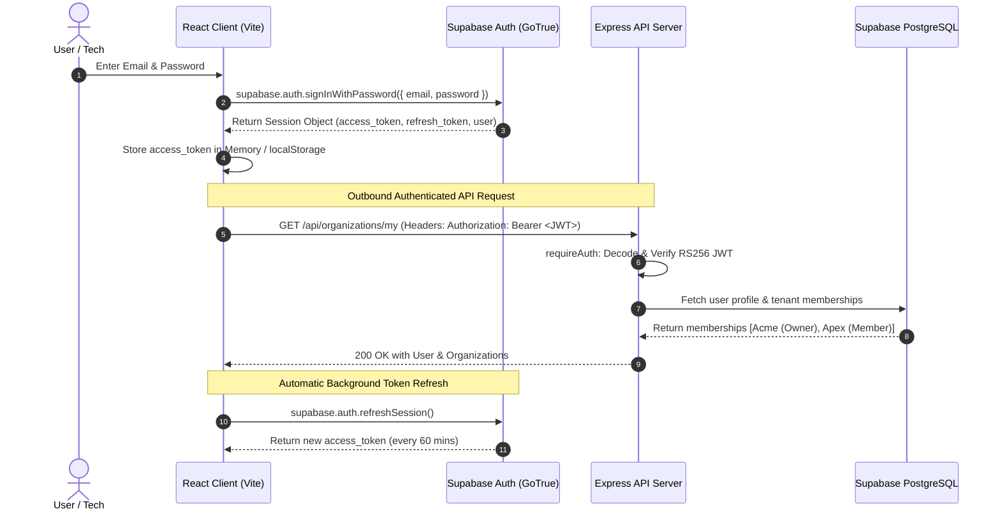
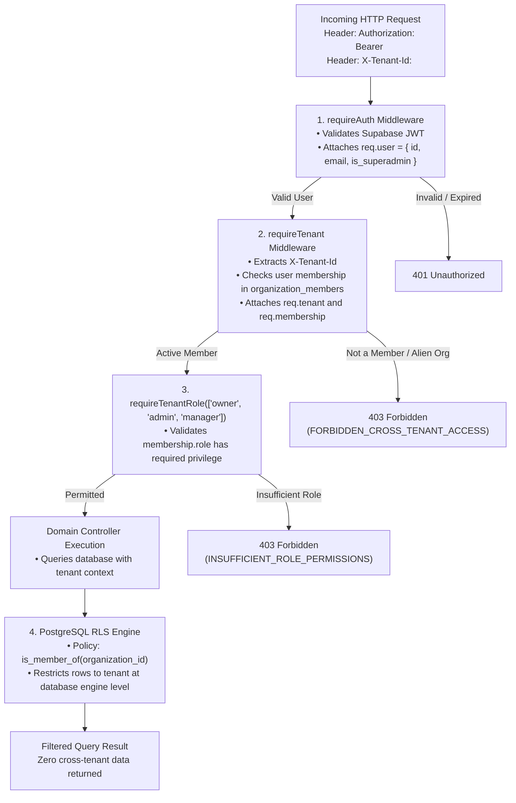
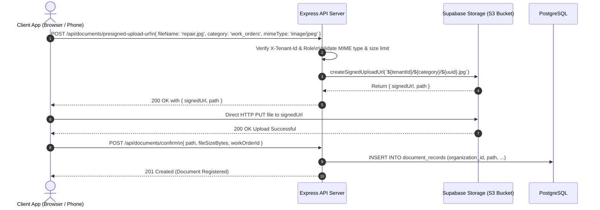

# OpsPilot — Complete System Architecture Blueprint

**Document Version:** 1.0.0  
**Status:** Approved Architectural Specification  
**Authors:** Senior Software Architect & PostgreSQL Database Architect  
**Target Delivery Window:** 8–12 Weeks (Solo Developer / Rapid Delivery)  
**System:** OpsPilot — Multi-Tenant Enterprise Operations & Workforce Management SaaS

---

## Table of Contents

1. [High-Level Architecture Diagram](#1-high-level-architecture-diagram)
2. [Frontend Architecture](#2-frontend-architecture)
3. [Backend Modular Monolith Architecture](#3-backend-modular-monolith-architecture)
4. [Database Architecture & Data Models](#4-database-architecture--data-models)
5. [Authentication Flow & Session Lifecycle](#5-authentication-flow--session-lifecycle)
6. [Authorization Flow & Dual-Tier RBAC](#6-authorization-flow--dual-tier-rbac)
7. [Multi-Tenant Architecture & Isolation Engine](#7-multi-tenant-architecture--isolation-engine)
8. [API Communication Flow & Protocol Standards](#8-api-communication-flow--protocol-standards)
9. [Real-Time Communication Architecture](#9-real-time-communication-architecture)
10. [File Upload & Storage Architecture](#10-file-upload--storage-architecture)
11. [Error-Handling Architecture](#11-error-handling-architecture)
12. [Logging, Auditing & Monitoring](#12-logging-auditing--monitoring)
13. [Deployment & Infrastructure Architecture](#13-deployment--infrastructure-architecture)
14. [Technology Decision Matrix & Architectural Rationale](#14-technology-decision-matrix--architectural-rationale)

---

## 1. High-Level Architecture Diagram

OpsPilot is engineered as a **Modular Monolith** deployed alongside a managed PostgreSQL database, authentication engine, and object storage cluster powered by Supabase.



---

## 2. Frontend Architecture

### 2.1 Technology Stack & Organization

The frontend is constructed as a modern Single Page Application (SPA) using:

- **Core Framework:** React 19 (JavaScript ES2024)
- **Build Tooling:** Vite 6 with Hot Module Replacement (HMR)
- **Styling:** Tailwind CSS with custom enterprise design tokens
- **State Management:** Redux Toolkit (RTK) with modular feature slices
- **Routing:** React Router v7 with protected route hierarchies and tenant context guards
- **Icons & UI Primitives:** Lucide React

### 2.2 Directory Structure

```
client/
├── index.html
├── vite.config.js
├── tailwind.config.js
├── postcss.config.js
├── src/
│   ├── assets/              # Static brand SVG icons, default avatars
│   ├── components/          # Shared reusable dumb/presentational UI components
│   │   ├── common/          # Button, Modal, Badge, Card, Table, EmptyState
│   │   ├── forms/           # Input, Select, DatePicker, Toggle, FormError
│   │   └── feedback/        # Toast, Loader, ConfirmDialog, StatWidget
│   ├── layouts/             # Structural frame layouts
│   │   ├── AppLayout.jsx    # Primary dashboard layout with Sidebar + Navbar
│   │   ├── AuthLayout.jsx   # Clean canvas for Login, Reset Password, Onboarding
│   │   ├── Navbar.jsx       # Header with Tenant Switcher, Profile & QA Simulator
│   │   └── Sidebar.jsx      # Domain navigation with RLS status indicator
│   ├── modules/             # Modular domain features
│   │   ├── auth/            # Login, Registration, PasswordReset components
│   │   ├── workforce/       # WorkforceDirectory, EmployeeModal, StaffDetails
│   │   ├── shifts/          # ShiftCalendar, ShiftModal, ClockInOutButton
│   │   ├── dispatch/        # WorkOrderBoard, WorkOrderDetail, StatusStepper
│   │   ├── assets/          # AssetList, AssetCheckoutModal, MaintenanceHistory
│   │   ├── documents/       # DocumentVault, FileUploader, SignedUrlViewer
│   │   └── audit/           # AuditLogViewer, DiffViewer, ExportButton
│   ├── pages/               # Route view components
│   ├── routes/              # AppRoutes.jsx, ProtectedRoute.jsx, RoleGuard.jsx
│   ├── services/            # apiClient.js (Axios), supabaseClient.js (Anon only)
│   ├── store/               # Redux Toolkit store and slices
│   │   ├── store.js         # Central configureStore
│   │   ├── authSlice.js     # User, token, session state
│   │   ├── tenantSlice.js   # Active organization, available tenants, switcher
│   │   └── uiSlice.js       # Sidebar toggle, active modals, notifications
│   ├── utils/               # formatters.js, validators.js, geoUtils.js
│   ├── App.jsx
│   ├── index.css
│   └── main.jsx
```

### 2.3 State Management Architecture (Redux Toolkit)

The client state is partitioned into three core slices to decouple network, identity, and UI concerns:



### 2.4 Route Hierarchy and Route Guards

```
/login                     -> Public (AuthLayout)
/register                  -> Public (AuthLayout)
/forgot-password           -> Public (AuthLayout)

/ (AppLayout)              -> Protected (Requires Authenticated Session)
├── /                      -> DashboardPage (Operational Overview & KPIs)
├── /workforce             -> WorkforcePage (Staff Directory & Profiles)
├── /shifts                -> ShiftsPage (Shift Planner & Clock-In)
├── /dispatch              -> DispatchPage (Work Order Board & Execution)
├── /assets                -> AssetsPage (Equipment Registry & Checkouts)
├── /documents             -> DocumentsPage (Multi-Tenant Vault)
├── /audit                 -> AuditPage (Immutable Audit Trail)
├── /organizations         -> OrganizationsPage (Tenant Settings & Switcher)
└── /portal (Customer)     -> CustomerPortalPage (Tickets & Approvals)
```

---

## 3. Backend Modular Monolith Architecture

### 3.1 Why a Modular Monolith?

A Modular Monolith provides the **domain isolation and clean boundaries** of microservices without the operational overhead of distributed transactions, network latency, multiple deployment pipelines, and complex service meshes. For a solo engineer delivering within 2–3 months, this maximizes developer velocity while remaining enterprise-grade and maintainable.

### 3.2 Modular Monolith Structure

Each domain resides in its own isolated module under `server/src/modules/` containing its own controllers, services, validation schemas, and routes:

```
server/
├── src/
│   ├── config/              # env.js, supabase.js (admin client)
│   ├── database/            # pgPool.js, migrate.js, schema.sql
│   ├── middleware/          # authMiddleware.js, tenantMiddleware.js, errorMiddleware.js
│   ├── modules/
│   │   ├── auth/            # Authentication & session verification
│   │   ├── organizations/   # Tenants, workspaces, members, invitations
│   │   ├── workforce/       # Staff directory, skills, hourly rates
│   │   ├── shifts/          # Shift scheduling, calendar, clock-in/out
│   │   ├── dispatch/        # Work orders, tasks, proof-of-work
│   │   ├── assets/          # Equipment registry, maintenance logs
│   │   ├── documents/       # Storage presigned URLs, metadata registry
│   │   └── audit/           # Audit trail logging service & queries
│   ├── utils/               # logger.js, responseHandler.js, errors.js
│   ├── app.js               # Express app configuration & middleware mounts
│   └── server.js            # HTTP server startup
```

### 3.3 Domain Decoupling & In-Process Communication

To prevent tight coupling between modules, domains communicate across boundaries via **Service Interface Contracts** and an **In-Process Domain Event Emitter** (`EventEmitter`):

```mermaid
flowchart TD
    subgraph "Dispatch Domain"
        DispatchService["WorkOrderService.completeWorkOrder(id)"]
    end

    subgraph "Event Bus (In-Process)"
        EventBus["EventEmitter (DomainEvents)"]
    end

    subgraph "Audit Domain"
        AuditListener["AuditService.recordEvent()"]
    end

    subgraph "Realtime Notification Domain"
        RealtimeListener["RealtimeService.broadcastTenantUpdate()"]
    end

    DispatchService -->|emit('WORK_ORDER_COMPLETED')| EventBus
    EventBus --> AuditListener
    EventBus --> RealtimeListener
```

---

## 4. Database Architecture & Data Models

### 4.1 PostgreSQL Database Engine & Extensions

- Engine: Supabase PostgreSQL 15+
- Extensions Enabled: `uuid-ossp`, `pgcrypto`, `pg_trgm` (fuzzy text search)

### 4.2 Entity Relationship Diagram (ERD)

```mermaid
erDiagram
    ORGANIZATIONS ||--o{ USERS_PROFILES : "provisions"
    ORGANIZATIONS ||--o{ ORGANIZATION_MEMBERS : "contains"
    USERS_PROFILES ||--o{ ORGANIZATION_MEMBERS : "participates_as"
    ORGANIZATIONS ||--o{ WORKFORCE_MEMBERS : "employs"
    ORGANIZATIONS ||--o{ SHIFT_SCHEDULES : "schedules"
    WORKFORCE_MEMBERS ||--o{ SHIFT_SCHEDULES : "assigned_to"
    WORKFORCE_MEMBERS ||--o{ ATTENDANCE_RECORDS : "clocks"
    ORGANIZATIONS ||--o{ WORK_ORDERS : "owns"
    WORKFORCE_MEMBERS ||--o{ WORK_ORDERS : "executes"
    ORGANIZATIONS ||--o{ ASSETS : "tracks"
    ASSETS ||--o{ WORK_ORDERS : "allocated_to"
    ORGANIZATIONS ||--o{ AUDIT_LOGS : "records"
    USERS_PROFILES ||--o{ AUDIT_LOGS : "triggers"

    ORGANIZATIONS {
        uuid id PK
        string name
        string slug UK
        string subscription_tier
        boolean is_active
        jsonb settings
        timestamptz created_at
        timestamptz updated_at
        timestamptz deleted_at
    }

    USERS_PROFILES {
        uuid id PK
        string email UK
        string full_name
        text avatar_url
        string phone
        boolean is_superadmin
        timestamptz created_at
        timestamptz updated_at
        timestamptz deleted_at
    }

    ORGANIZATION_MEMBERS {
        uuid id PK
        uuid organization_id FK
        uuid user_id FK
        string role "owner|admin|manager|employee|customer"
        string status "active|invited|suspended"
        uuid invited_by FK
        timestamptz joined_at
        timestamptz created_at
        timestamptz updated_at
    }

    WORKFORCE_MEMBERS {
        uuid id PK
        uuid organization_id FK
        uuid user_id FK
        string employee_code UK_per_tenant
        string first_name
        string last_name
        string email
        string phone
        string department
        string designation
        string employment_type
        numeric hourly_rate
        string status "active|on_leave|terminated"
        timestamptz created_at
        timestamptz updated_at
        timestamptz deleted_at
    }

    SHIFT_SCHEDULES {
        uuid id PK
        uuid organization_id FK
        uuid workforce_member_id FK
        timestamptz start_time
        timestamptz end_time
        string department
        string location_name
        point location_coordinates
        string status "scheduled|in_progress|completed|cancelled"
        timestamptz created_at
        timestamptz deleted_at
    }

    ATTENDANCE_RECORDS {
        uuid id PK
        uuid organization_id FK
        uuid workforce_member_id FK
        uuid shift_id FK
        timestamptz clock_in_time
        point clock_in_coordinates
        boolean clock_in_geofence_verified
        timestamptz clock_out_time
        point clock_out_coordinates
        numeric total_hours
        numeric break_minutes
        string status "pending_approval|approved|disputed"
        uuid approved_by FK
        timestamptz created_at
    }

    WORK_ORDERS {
        uuid id PK
        uuid organization_id FK
        uuid customer_id FK
        uuid assigned_workforce_id FK
        uuid allocated_asset_id FK
        string title
        text description
        string priority "low|medium|high|urgent"
        string status "draft|scheduled|dispatched|en_route|in_progress|completed|approved|invoiced"
        timestamptz scheduled_start
        timestamptz scheduled_end
        text customer_signature_url
        jsonb completion_notes
        timestamptz created_at
        timestamptz updated_at
        timestamptz deleted_at
    }

    ASSETS {
        uuid id PK
        uuid organization_id FK
        string asset_tag UK_per_tenant
        string name
        string category "vehicle|heavy_machinery|diagnostic_tool"
        string status "available|assigned|maintenance|retired"
        jsonb metadata
        timestamptz created_at
        timestamptz updated_at
        timestamptz deleted_at
    }

    AUDIT_LOGS {
        uuid id PK
        uuid organization_id FK
        uuid user_id FK
        string action
        string entity_type
        string entity_id
        jsonb old_values
        jsonb new_values
        string ip_address
        string user_agent
        timestamptz created_at
    }
```

### 4.3 Soft Deletion Architecture

To prevent catastrophic cascading deletes of operational history, all primary tables implement universal soft deletion via:

```sql
ALTER TABLE public.workforce_members ADD COLUMN deleted_at TIMESTAMPTZ DEFAULT NULL;
CREATE INDEX idx_workforce_members_active ON public.workforce_members(organization_id) WHERE deleted_at IS NULL;
```

All read queries and RLS policies include `WHERE deleted_at IS NULL`. Hard deletes are strictly prohibited by omitting `DELETE` policies on audit logs and historical operational records.

---

## 5. Authentication Flow & Session Lifecycle

Authentication is handled securely via **Supabase Auth (GoTrue)**. Session tokens are standard cryptographically signed RS256 JWTs.



---

## 6. Authorization Flow & Dual-Tier RBAC

OpsPilot implements a **Dual-Tier Defense-in-Depth Authorization Model**:

1. **Tier 1 (Application Layer):** Express middleware validates tenant context and user role before executing domain code.
2. **Tier 2 (Database Layer):** PostgreSQL Row Level Security (RLS) policies mathematically restrict rows returned by any query based on the executing user's UUID.



---

## 7. Multi-Tenant Architecture & Isolation Engine

### 7.1 Tenant Context Resolution

The active tenant is resolved dynamically per request using the `X-Tenant-Id` HTTP header:

1. When a user switches organizations in the UI dropdown, Redux updates `currentTenant` and writes the UUID to `localStorage.setItem('opspilot_active_tenant_id', id)`.
2. The Axios client interceptor attaches `X-Tenant-Id: <UUID>` to every outbound HTTP call.
3. The Express `requireTenant` middleware verifies that the user actually belongs to that organization:
   ```javascript
   const membership = await db.query(
     'SELECT role, status FROM organization_members WHERE organization_id = $1 AND user_id = $2 AND status = $3',
     [tenantId, req.user.id, 'active']
   );
   ```
4. If valid, `req.tenant` and `req.membership` are attached to the request object. If invalid, the request is rejected immediately with `403 Forbidden`.

### 7.2 Proof of Zero Data Leakage

Even if an application developer inadvertently writes:

```sql
SELECT * FROM workforce_members; -- Missing WHERE organization_id = x
```

The **PostgreSQL RLS engine** intercepts the statement:

```sql
CREATE POLICY "Members can view workforce in their organization"
ON public.workforce_members FOR SELECT
USING (
    public.is_member_of(organization_id) OR public.is_superadmin()
);
```

The query execution plan will automatically append the internal security filter, making cross-tenant data leakage mathematically impossible.

---

## 8. API Communication Flow & Protocol Standards

### 8.1 Standardized Response Envelope

All API endpoints return a predictable JSON envelope:

#### Success Response (200 / 201)

```json
{
  "success": true,
  "message": "Workforce directory retrieved",
  "data": [ ... ],
  "meta": {
    "page": 1,
    "limit": 25,
    "totalCount": 85,
    "timestamp": "2026-11-04T16:20:00Z"
  }
}
```

#### Error Response (400 / 401 / 403 / 404 / 500)

```json
{
  "success": false,
  "error": {
    "code": "FORBIDDEN_CROSS_TENANT_ACCESS",
    "message": "Access Denied: You do not have active membership in this organization",
    "details": null
  },
  "meta": {
    "timestamp": "2026-11-04T16:20:00Z"
  }
}
```

### 8.2 Standardized Pagination Protocol

All list endpoints enforce pagination parameters:

- `page`: Integer $\ge 1$ (default: `1`)
- `limit`: Integer between `1` and `100` (default: `25`)
- Returns `meta.totalCount` and `meta.hasMore` for infinite-scroll or paginated tables.

---

## 9. Real-Time Communication Architecture

### 9.1 Architecture: Supabase Realtime (WebSocket CDC)

Instead of operating an independent Socket.IO server (which introduces complex sticky sessions and horizontal clustering overhead for a solo developer), OpsPilot utilizes **Supabase Realtime**.

Supabase Realtime captures PostgreSQL **Change Data Capture (CDC)** events from the Write-Ahead Log (WAL) and broadcasts them over WebSockets directly to subscribed client channels:

```mermaid
sequenceDiagram
    autonumber
    actor Tech as Field Technician
    actor Dispatcher as Dispatch Coordinator
    participant API as Express API
    participant DB as PostgreSQL
    participant RT as Supabase Realtime Engine

    Dispatcher->>Client: Open Dispatch Dashboard
    Client->>RT: Subscribe to Channel "tenant-orders:<org_id>"

    Tech->>API: POST /api/dispatch/:id/status { status: 'COMPLETED' }
    API->>DB: UPDATE work_orders SET status = 'COMPLETED' WHERE id = :id
    DB->>RT: WAL Change Event (UPDATE on work_orders)
    RT->>Client: WebSocket Broadcast: { event: 'UPDATE', new: { id, status: 'COMPLETED' } }
    Client->>Client: Redux updates state; Work Order card turns Green instantly!
```

### 9.2 Channel Security Partitioning

Channels are strictly partitioned by organization ID:

- Channel name: `realtime:tenant:{organization_id}:dispatch`
- The client passes their Supabase JWT when connecting to the WebSocket; Supabase Realtime verifies the JWT against PostgreSQL RLS to ensure clients can **only** receive broadcasts for their own tenant.

---

## 10. File Upload & Storage Architecture

### 10.1 Two-Phase Presigned URL Upload Pattern

To preserve backend server bandwidth and prevent memory bloat, large file uploads (work order photos, PDF certificates) **never stream through Express**. Instead, a secure Two-Phase Presigned URL pattern is used:



### 10.2 Bucket Security & Tenant Folder Isolation

- Bucket: `org-documents` (Private)
- Object Storage Path: `/{organization_id}/{category}/{year}/{month}/{file_uuid}.{ext}`
- Supabase Storage RLS Policy enforces:
  ```sql
  CREATE POLICY "Tenant Members can read tenant documents"
  ON storage.objects FOR SELECT
  USING (
      bucket_id = 'org-documents' AND
      (storage.foldername(name))[1]::uuid IN (
          SELECT organization_id FROM public.organization_members WHERE user_id = auth.uid()
      )
  );
  ```

---

## 11. Error-Handling Architecture

### 11.1 Error Hierarchy

OpsPilot utilizes a structured, custom error hierarchy inheriting from standard `Error`:

```
AppError (Base class: message, statusCode, code, isOperational)
├── ValidationError (400, 'VALIDATION_ERROR', details)
├── UnauthorizedError (401, 'UNAUTHORIZED')
├── TenantContextError (400, 'TENANT_HEADER_REQUIRED')
├── ForbiddenError (403, 'FORBIDDEN_CROSS_TENANT_ACCESS')
├── NotFoundError (404, 'NOT_FOUND')
└── ConflictError (409, 'CONFLICT')
```

### 11.2 Centralized Error Middleware (`errorMiddleware.js`)

All route handlers wrap async logic or rely on Express async error forwarding (`next(err)`). The centralized error handler:

1. Logs the error stack with timestamp and request metadata via `logger.error()`.
2. Hides internal database stack traces in production (`env.isProduction`).
3. Sends the standard error envelope.

### 11.3 Frontend Error Boundaries & Toast Handlers

- React Error Boundaries capture unexpected UI rendering crashes and present a clean "Something went wrong — Reload Workspace" fallback.
- Axios response interceptor displays user-friendly transient toast alerts for network disconnects (HTTP 0) or permission rejections (HTTP 403).

---

## 12. Logging, Auditing & Monitoring

### 12.1 Structured Logging (Pino / Winston Pattern)

All logs are emitted as structured JSON in production for automated ingestion:

```json
{
  "level": "info",
  "timestamp": "2026-11-04T16:22:15.120Z",
  "service": "opspilot-api",
  "tenantId": "11111111-1111-1111-1111-111111111111",
  "userId": "aaaaaaaa-aaaa-aaaa-aaaa-aaaaaaaaaaaa",
  "method": "POST",
  "url": "/api/workforce",
  "statusCode": 201,
  "responseTimeMs": 34.2
}
```

### 12.2 Immutable Append-Only Audit Trail (`public.audit_logs`)

Every state-modifying action (create, update, delete, status transition) triggers an audit log record:

- Stores `old_values` (JSONB) and `new_values` (JSONB) for side-by-side diffing.
- Records client IP address and User-Agent.
- Database RLS guarantees immutability: **no `UPDATE` or `DELETE` permissions** exist on `public.audit_logs`.

### 12.3 System Health Endpoint (`/api/health`)

Provides automated uptime monitoring tools (e.g., UptimeRobot, Datadog) with instant status:

- Returns `status: "healthy"`, uptime seconds, PostgreSQL connection pool state, and memory consumption.

---

## 13. Deployment & Infrastructure Architecture

### 13.1 Production Topology

OpsPilot is designed for low-cost, high-reliability deployment on standard modern cloud infrastructure (e.g. Render, Railway, DigitalOcean, or AWS ECS):

```mermaid
flowchart LR
    subgraph "Public Internet"
        Users["Global Users & Field Mobile Web"]
    end

    subgraph "CDN & Edge Routing"
        Cloudflare["Cloudflare CDN & WAF\n• Free SSL\n• Asset Caching\n• DDoS Shield"]
    end

    subgraph "Application Hosting (Containerized)"
        WebContainer["Client Static Container (Nginx)\nHosting React Production SPA"]
        APIContainer["Node.js / Express Server Container\n(Dockerized Cluster)"]
    end

    subgraph "Database & Storage Cloud"
        SupabaseCloud["Supabase Managed Cluster\n• PostgreSQL 15\n• PgBouncer Connection Pool\n• Automated Daily Backups\n• S3 Storage Cluster"]
    end

    Users --> Cloudflare
    Cloudflare -->|/* (Static UI)| WebContainer
    Cloudflare -->|/api/*| APIContainer
    APIContainer -->|Pooled Connections| SupabaseCloud
```

### 13.2 Containerization Strategy (Docker)

A production multi-stage `Dockerfile` is provided for zero-dependency container deployment:

- **Stage 1 (Builder):** Compiles Vite React frontend into optimized static bundle.
- **Stage 2 (Runtime):** Lightweight Node.js Alpine image running Express API and serving static assets with gzip compression.

---

## 14. Technology Decision Matrix & Architectural Rationale

| Architecture Choice      | Selected Technology                | Alternative Considered         | Why Selected over Alternative?                                                                                                                                                                                                          |
| ------------------------ | ---------------------------------- | ------------------------------ | --------------------------------------------------------------------------------------------------------------------------------------------------------------------------------------------------------------------------------------- |
| **Frontend Framework**   | **React 19 + Vite 6**              | Next.js / Remix                | OpsPilot is an authenticated enterprise SPA dashboard with zero need for SEO. Vite + React delivers instant builds, simpler deployment (static Nginx/S3), zero SSR hydration bugs, and full compatibility with mobile web.              |
| **Backend Architecture** | **Modular Monolith (Express)**     | Microservices                  | Microservices introduce massive devops overhead, distributed tracing, and network latency. A modular monolith allows a solo developer to develop rapidly in a single repository while preserving strict domain boundaries.              |
| **Database & Auth**      | **Supabase PostgreSQL + RLS**      | MongoDB / Prisma / Custom Auth | PostgreSQL provides rock-solid relational integrity and ACID transactions. Supabase eliminates months of bespoke auth/storage development and provides database-level Row Level Security (RLS) for mathematical multi-tenant isolation. |
| **State Management**     | **Redux Toolkit (RTK)**            | Zustand / Context API          | RTK provides standardized DevTools, predictable state transitions, and structured async thunks ideal for complex enterprise multi-tenant state (tenant switching, session syncing, RBAC guards).                                        |
| **CSS & Design**         | **Tailwind CSS**                   | Material UI / Chakra           | Tailwind compiles to ultra-lightweight CSS ($< 25\text{ KB}$), produces zero runtime CSS-in-JS overhead, and enables building an enterprise high-contrast dark/light design system effortlessly.                                        |
| **Realtime Engine**      | **Supabase Realtime**              | Socket.IO Server               | Supabase Realtime hooks directly into PostgreSQL WAL change streams with zero custom socket server maintenance, eliminating sticky sessions and Redis adapter clustering.                                                               |
| **File Storage**         | **Supabase Storage (Signed URLs)** | Express Multipart Uploads      | Offloads high-bandwidth uploads directly from client to S3-compatible cloud storage, protecting backend Node.js event loop from memory bloat.                                                                                           |

---

**End of System Architecture Specification**  
_Document verified and ready for implementation._
