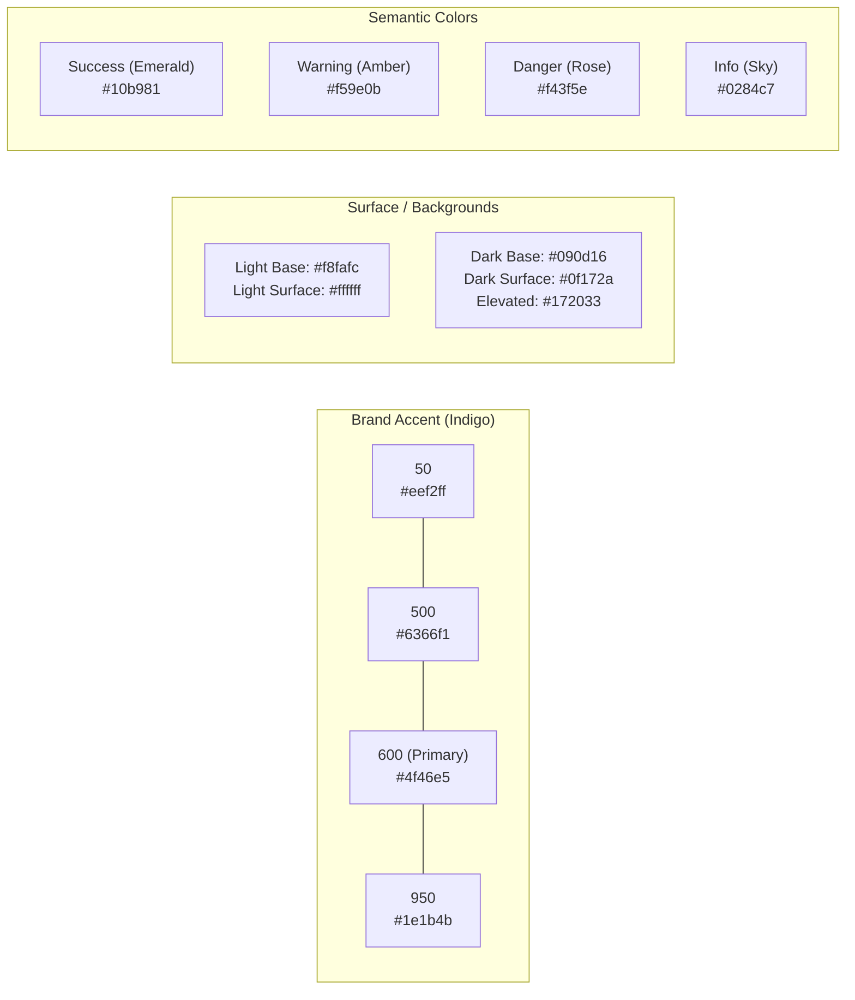

# OpsPilot — Enterprise UI Design System Specification

**Design System Version:** 1.0.0  
**Design Direction:** Modern B2B SaaS — Clean, Premium, Minimal, High-Contrast  
**Target:** Desktop Dashboard, Field Mobile Web, Customer Portal  
**Framework:** React 19, Tailwind CSS, Lucide Icons, Redux Toolkit

---

## 1. Visual Foundation & Design Tokens

### 1.1 Color Palette



#### Token Palette Specifications

- **Brand Primary:**
  - Light Mode Accent: `indigo-600` (`#4f46e5`)
  - Dark Mode Accent: `indigo-500` (`#6366f1`)
  - Focus Rings: `focus:ring-indigo-500/20`
- **Neutrals (Slate):**
  - `slate-50` to `slate-950` providing high-contrast text and border separation.
- **Surface Backgrounds:**
  - Light Mode: Base `#f8fafc` (`slate-50`), Surfaces `#ffffff`
  - Dark Mode: Base `#090d16` (`surface-950`), Cards `#0f172a` (`surface-900`), Elevated Modals `#172033` (`surface-850`)
- **Semantic Feedback:**
  - **Success:** `emerald-600` (light) / `emerald-400` (dark), with `emerald-50` / `emerald-950/60` backdrops.
  - **Warning:** `amber-600` (light) / `amber-400` (dark), with `amber-50` / `amber-950/60` backdrops.
  - **Danger:** `rose-600` (light) / `rose-400` (dark), with `rose-50` / `rose-950/60` backdrops.
  - **Info:** `sky-600` (light) / `sky-400` (dark), with `sky-50` / `sky-950/60` backdrops.

---

### 1.2 Typography System

- **Primary Sans-Serif:** `Plus Jakarta Sans`, `Inter`, `system-ui`, `-apple-system`, `sans-serif`
- **Monospace / Code / IDs:** `JetBrains Mono`, `monospace` (used for `employee_code`, UUIDs, timestamps, and currency amounts)

| Type Token             | Font Size          | Line Height | Weight          | Tracking   | Usage                          |
| ---------------------- | ------------------ | ----------- | --------------- | ---------- | ------------------------------ |
| **Display Heading**    | `2rem` (32px)      | `2.5rem`    | Extrabold (800) | `-0.025em` | Hero titles & KPI main digits  |
| **Section Heading**    | `1.5rem` (24px)    | `2rem`      | Bold (700)      | `-0.02em`  | Page headers                   |
| **Card / Modal Title** | `1.125rem` (18px)  | `1.5rem`    | Bold (700)      | `-0.015em` | Card headers, Dialog titles    |
| **Body Large**         | `0.875rem` (14px)  | `1.25rem`   | Medium (500)    | Normal     | Primary table content, inputs  |
| **Body Regular**       | `0.75rem` (12px)   | `1rem`      | Normal (400)    | Normal     | Metadata, descriptions, badges |
| **Caption / Code**     | `0.6875rem` (11px) | `0.875rem`  | Mono (500)      | `+0.025em` | UUIDs, Slugs, Timestamps       |

---

### 1.3 Spacing & Layout Grid

- Consistent 4px base increment (`0.25rem` = 4px, `0.5rem` = 8px, `0.75rem` = 12px, `1rem` = 16px, `1.5rem` = 24px, `2rem` = 32px).
- Form spacing: `gap-3` (12px) for related form fields; `space-y-4` (16px) for form sections.
- Page margins: `p-4 sm:p-6 lg:p-8` with max layout width `max-w-7xl mx-auto`.

---

### 1.4 Border Radii & Elevation

- **Input & Select Radii:** `rounded-xl` (12px)
- **Button Radii:** `rounded-xl` (12px) for `md`/`lg`; `rounded-lg` (8px) for `sm`
- **Card & Table Container Radii:** `rounded-2xl` (16px) to `rounded-3xl` (24px)
- **Modal & Dialog Radii:** `rounded-3xl` (24px)
- **Badge Radii:** `rounded-full` (9999px)
- **Shadow Hierarchy:**
  - `shadow-sm`: Cards and dropdown buttons.
  - `shadow-md`: Interactive hover states and primary buttons.
  - `shadow-xl`: Popover dropdowns and slide-over drawers.
  - `shadow-2xl`: Modals and floating toast notifications.

---

## 2. Reusable Component Catalog & API Reference

All reusable components are located in `client/src/components/ui/` and exported via `client/src/components/ui/index.js`.

```
client/src/components/ui/
├── Button.jsx          # Multi-variant button with loading spinner
├── Input.jsx           # Form input with floating icons, label, error
├── Select.jsx          # Styled select dropdown
├── Dropdown.jsx        # Popover action menu with click-outside
├── Card.jsx            # Composite card (Header, Title, Content, Footer)
├── Table.jsx           # Enterprise data table with subtle dividing lines
├── Badge.jsx           # Status badge with optional live pulsing dot
├── Modal.jsx           # Accessible dialog with ESC dismissal
├── Drawer.jsx          # Slide-over details drawer
├── Toast.jsx           # Auto-dismissing notification toasts
├── Skeleton.jsx        # Pulse loading placeholders (Card, Table, Text)
├── EmptyState.jsx      # Empty roster / search illustration
├── ErrorState.jsx      # Error banner with retry trigger
├── ThemeToggle.jsx     # Dark / Light theme switch
└── index.js            # Barrel export
```

### 2.1 Button (`<Button />`)

```jsx
import { Button } from '../components/ui';
import { Plus } from 'lucide-react';

<Button
  variant="primary" // 'primary' | 'secondary' | 'outline' | 'ghost' | 'danger' | 'success'
  size="md" // 'xs' | 'sm' | 'md' | 'lg'
  leftIcon={Plus}
  isLoading={isSubmitting}
  loadingText="Saving..."
  onClick={handleSave}
>
  Add Employee
</Button>;
```

### 2.2 Input (`<Input />`)

```jsx
import { Input } from '../components/ui';
import { Search } from 'lucide-react';

<Input
  label="Search Staff"
  placeholder="Type a name..."
  leftIcon={Search}
  value={query}
  onChange={(e) => setQuery(e.target.value)}
  error={validationErrors.search}
  helperText="Search by first name or employee ID"
/>;
```

### 2.3 Status Badge (`<Badge />`)

```jsx
import { Badge } from '../components/ui';

<Badge variant="success" size="sm" dot pulseDot>
  Active on Duty
</Badge>;
```

### 2.4 Data Table (`<Table />`)

```jsx
import { Table, TableHeader, TableBody, TableRow, TableHead, TableCell } from '../components/ui';

<Table>
  <TableHeader>
    <TableRow hover={false}>
      <TableHead>Employee</TableHead>
      <TableHead>Department</TableHead>
      <TableHead>Status</TableHead>
    </TableRow>
  </TableHeader>
  <TableBody>
    <TableRow>
      <TableCell>David Miller</TableCell>
      <TableCell>Fleet Operations</TableCell>
      <TableCell>
        <Badge variant="success" dot>
          Active
        </Badge>
      </TableCell>
    </TableRow>
  </TableBody>
</Table>;
```

### 2.5 Toast Notification (`addToast`)

```jsx
import { useDispatch } from 'react-redux';
import { addToast } from '../../store/uiSlice.js';

const dispatch = useDispatch();
dispatch(
  addToast({
    type: 'success', // 'success' | 'error' | 'warning' | 'info'
    title: 'Workforce Member Added',
    message: 'Elena Rostova was attached to Acme Logistics Global.',
    duration: 4000
  })
);
```

---

## 3. Light and Dark Theme Architecture

OpsPilot implements a unified theme architecture using Tailwind CSS's `class` dark mode strategy:

1. **State Persistence:** `uiSlice` reads and writes `localStorage.getItem('opspilot_theme')` (`'dark'` or `'light'`).
2. **HTML Class Toggle:** When `theme === 'dark'`, the `dark` class is set on `document.documentElement`, activating all `dark:...` utility rules and dark CSS variables.
3. **One-Click Theme Toggle:** Integrated into the Navbar and Login screens via `<ThemeToggle />`.

---

## 4. Accessibility (a11y) & WCAG 2.1 AA Compliance

- **Contrast Ratios:** All body text meets or exceeds a $4.5:1$ contrast ratio in both dark and light modes.
- **Keyboard Navigation:** Modals and Drawers trap focus and dismiss on `Escape` key press. Dropdowns support click-outside listener cleanup.
- **Focus States:** High-visibility focus rings (`focus:ring-2 focus:ring-indigo-500/20`) enabled for all interactive inputs and buttons.
- **Semantic Roles:** ARIA roles (`role="dialog"`, `role="menu"`, `role="alert"`, `aria-modal="true"`) populated across all feedback and overlay primitives.

---

**End of Enterprise UI Design System Specification**
