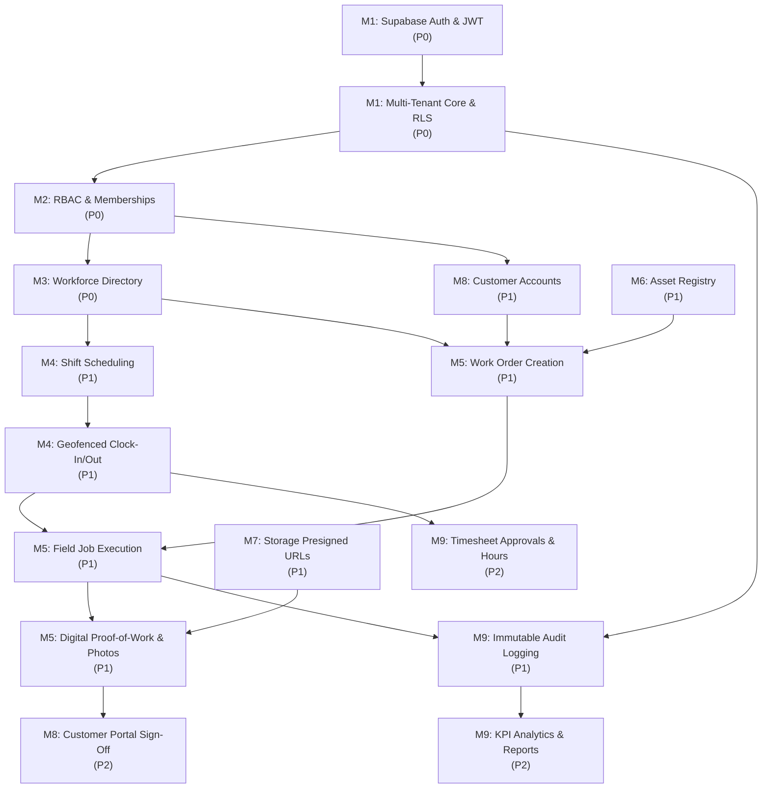

# OpsPilot — Feature Inventory & Dependency Mapping

**Document Version:** 1.0.0  
**Status:** Approved Feature Specification & Implementation Map  
**Target Delivery Window:** 8–12 Weeks (Solo Developer / Rapid Delivery)  
**System:** OpsPilot — Multi-Tenant Enterprise Operations & Workforce Management SaaS

---

## Table of Contents

1. [Feature Priority Classification Standard](#1-feature-priority-classification-standard)
2. [Master Feature Dependency Graph](#2-master-feature-dependency-graph)
3. [Topological Implementation Order (Build Sequence)](#3-topological-implementation-order-build-sequence)
4. [Module 1: Multi-Tenant Core & Identity Management](#4-module-1-multi-tenant-core--identity-management)
5. [Module 2: Role-Based Access Control (RBAC) & Member Management](#5-module-2-role-based-access-control-rbac--member-management)
6. [Module 3: Workforce Directory & Staff Profiles](#6-module-3-workforce-directory--staff-profiles)
7. [Module 4: Shift Scheduling & Time Attendance](#7-module-4-shift-scheduling--time-attendance)
8. [Module 5: Field Operations & Work Order Dispatch](#8-module-5-field-operations--work-order-dispatch)
9. [Module 6: Asset & Equipment Registry](#9-module-6-asset--equipment-registry)
10. [Module 7: Multi-Tenant Document Vault](#10-module-7-multi-tenant-document-vault)
11. [Module 8: Customer Self-Service Portal](#11-module-8-customer-self-service-portal)
12. [Module 9: Enterprise Audit Logging & Analytics](#12-module-9-enterprise-audit-logging--analytics)
13. [Cross-Module Feature Matrix Summary](#13-cross-module-feature-matrix-summary)

---

## 1. Feature Priority Classification Standard

Every feature and subfeature is tagged according to the enterprise release framework:

| Priority Tag      | Definition                                                                                         | Delivery Horizon | Release Target                |
| ----------------- | -------------------------------------------------------------------------------------------------- | ---------------- | ----------------------------- |
| **P0: Essential** | Core foundational features without which the system cannot function or maintain tenant security.   | Weeks 1–4        | **MVP Alpha**                 |
| **P1: Important** | Primary operational capabilities delivering daily business value to dispatchers and field workers. | Weeks 5–8        | **MVP Beta**                  |
| **P2: Advanced**  | Enterprise governance, self-service portals, reporting, and audit capabilities.                    | Weeks 9–12       | **General Availability (GA)** |
| **P3: Future**    | Post-MVP optimizations (AI routing, native push notifications, automated accounting sync).         | Post-Launch      | **v2.0 Roadmap**              |

---

## 2. Master Feature Dependency Graph

The Mermaid dependency graph below illustrates the hard technical prerequisites that must be satisfied before downstream features can function.

---

## 3. Topological Implementation Order (Build Sequence)

To ensure zero blocked development cycles for a solo developer, features must be engineered in the following strict topological order:

1. **Step 1 (Milestone 1 - Complete):** Multi-tenant PostgreSQL RLS schema, Express modular monolith, `requireAuth` & `requireTenant` middleware, Redux store, and base frontend frame.
2. **Step 2 (Milestone 2):** Authentication flow, signup/login forms, organization onboarding wizard, tenant switcher.
3. **Step 3 (Milestone 3):** User invitation token system, RBAC role assignment (`owner`, `admin`, `manager`, `employee`, `customer`), member suspension.
4. **Step 4 (Milestone 4):** Workforce directory, skill badges, hourly rates, shift calendar, mobile point-in-time geofenced clock-in/out, and timesheet review.
5. **Step 5 (Milestone 5):** Work order lifecycle state machine, dispatcher board, mobile job execution, asset checkout allocation, digital signature on glass.
6. **Step 6 (Milestone 6):** Supabase Storage bucket integration, two-phase presigned upload URLs, categorized file attachments.
7. **Step 7 (Milestone 7):** Customer self-service portal, customer service tickets, live ticket tracker, completion receipt viewer.
8. **Step 8 (Milestone 8):** Immutable audit log viewer, JSON diff inspector, operational KPI cards, CSV export, Docker containerization, and production hardening.

---

## 4. Module 1: Multi-Tenant Core & Identity Management

### 4.1 Feature Breakdown

- **F1.1: Organization Provisioning & Onboarding Wizard [P0]**
  - Subfeatures: Company name entry, automatic URL slug generator, subscription tier selector (`starter`, `growth`, `enterprise`), default timezone and currency setup.
- **F1.2: Tenant Workspace Resolution & Isolation [P0]**
  - Subfeatures: Dynamic `X-Tenant-Id` header resolution, user membership verification, cross-tenant 403 rejection, PostgreSQL session variable setting.
- **F1.3: User Authentication & Session Refresh [P0]**
  - Subfeatures: Email/password authentication via Supabase Auth, JWT token decoding, silent 60-minute token refresh, secure localStorage synchronization.
- **F1.4: Workspace Switcher [P0]**
  - Subfeatures: Multi-organization discovery endpoint, instant workspace dropdown, Redux active tenant update, localStorage persistence.
- **F1.5: Organization Settings & Branding [P1]**
  - Subfeatures: Company logo upload, corporate address, primary theme color, operational timezone settings.

### 4.2 Engineering Specifications

- **Frontend Pages:** `/login`, `/register`, `/forgot-password`, `/organizations`
- **Backend APIs:**
  - `POST /api/auth/register` (Register user)
  - `POST /api/auth/login` (Login user)
  - `GET /api/auth/me` (Get active profile & memberships)
  - `GET /api/organizations/my` (Get all affiliated organizations)
  - `POST /api/organizations` (Create new tenant workspace)
  - `GET /api/organizations/current` (Get active tenant details)
  - `PUT /api/organizations/current` (Update active tenant settings)
- **Database Tables:** `public.organizations`, `public.users_profiles`, `public.organization_members`
- **User Permissions:** Public (Login/Register); Authenticated User (Create Org); Owner/Admin (Update Org Settings).
- **Dependencies:** Supabase Auth Engine, PostgreSQL schema migrations.
- **Validation Rules:**
  - `organizations.name`: 2–100 chars, required.
  - `organizations.slug`: Lowercase alphanumeric + hyphens only (`^[a-z0-9-]+$`), globally unique.
  - `users_profiles.email`: Valid RFC 5322 email.
- **Acceptance Criteria:**
  - **Given** an authenticated user with no organizations, **When** they fill the onboarding wizard with `"Apex Fleet"`, **Then** the organization is created, user is mapped as `owner`, and the active workspace is set to Apex Fleet.
- **Testing Requirements:**
  - Unit: Slug formatting and regex validation.
  - Integration: Cross-tenant breach test (attempting access with un-affiliated tenant ID returns 403).

---

## 5. Module 2: Role-Based Access Control (RBAC) & Member Management

### 5.1 Feature Breakdown

- **F2.1: Member Invitation System [P0]**
  - Subfeatures: Email invitation generation, cryptographically signed invite tokens (7-day TTL), role assignment (`admin`, `manager`, `employee`, `customer`), designated department.
- **F2.2: Invitation Acceptance Flow [P0]**
  - Subfeatures: Token validation endpoint, password set canvas, automatic membership activation.
- **F2.3: Role Assignment & Modification [P0]**
  - Subfeatures: Promote/demote members, protect Primary Owner role from accidental removal, audit role change events.
- **F2.4: Member Suspension & Revocation [P0]**
  - Subfeatures: Immediate session revocation, access lockout without data deletion (`status = 'suspended'`).
- **F2.5: Seat Limit Enforcement [P1]**
  - Subfeatures: Enforce active user count limits against subscription tier (Starter: 10, Growth: 50, Enterprise: 500).

### 5.2 Engineering Specifications

- **Frontend Pages:** `/organizations/members`, `/invite/accept?token=...`
- **Backend APIs:**
  - `GET /api/organizations/members` (List all tenant members)
  - `POST /api/organizations/members/invite` (Send member invitation)
  - `POST /api/organizations/members/accept` (Accept invite & activate)
  - `PUT /api/organizations/members/:id/role` (Update member role)
  - `POST /api/organizations/members/:id/suspend` (Suspend member)
  - `DELETE /api/organizations/members/:id` (Remove member from tenant)
- **Database Tables:** `public.organization_members`, `public.users_profiles`
- **User Permissions:** Owner / Admin only.
- **Dependencies:** Module 1 (Tenant Core & Auth).
- **Validation Rules:**
  - Cannot demote the sole `owner` of an organization.
  - Invited email must not already have an active membership in the same organization.
- **Acceptance Criteria:**
  - **Given** an Org Admin, **When** they invite `tech@acme.com` as `employee`, **Then** an invitation record is generated with a unique token, and the member appears in the directory as `status: 'invited'`.
- **Testing Requirements:**
  - Unit: Token generation and expiration logic.
  - Integration: Owner demotion prevention test; non-admin invitation attempt returns 403.

---

## 6. Module 3: Workforce Directory & Staff Profiles

### 6.1 Feature Breakdown

- **F3.1: Staff Directory Roster [P0]**
  - Subfeatures: Paginated employee table, searchable by name/code/email, department filters, employment type filters (`full_time`, `part_time`, `contract`, `intern`).
- **F3.2: Employee Profile Management [P0]**
  - Subfeatures: Employee ID (`EMP-XXXX`), contact details, job title, emergency contact, linked user profile.
- **F3.3: Skills & Certification Tracker [P1]**
  - Subfeatures: Technical competency tags, certificate document upload, expiration date tracking, expired certificate warning badges.
- **F3.4: Wage & Hourly Rate Card [P1]**
  - Subfeatures: Regular hourly rate, overtime rate multiplier, access restricted strictly to Admin and Manager roles.
- **F3.5: Employee Offboarding Cascade [P1]**
  - Subfeatures: Soft deletion (`deleted_at`), automated shift unassignment, alert dispatcher for active work orders.

### 6.2 Engineering Specifications

- **Frontend Pages:** `/workforce`, `/workforce/:id`
- **Backend APIs:**
  - `GET /api/workforce` (List workforce members with pagination & search)
  - `POST /api/workforce` (Create new workforce profile)
  - `GET /api/workforce/:id` (Get full employee profile)
  - `PUT /api/workforce/:id` (Update profile & skills)
  - `DELETE /api/workforce/:id` (Soft-delete employee & cascade unassign)
  - `GET /api/workforce/stats` (Workforce KPI counts)
- **Database Tables:** `public.workforce_members`, `public.users_profiles`
- **User Permissions:** Admin/Manager (Full CRUD); Employee (Read own profile); Customer (No Access).
- **Dependencies:** Module 1 (Tenant Core), Module 2 (RBAC).
- **Validation Rules:**
  - `employee_code`: Unique within organization (`uq_org_employee_code`).
  - `hourly_rate`: Numeric $\ge 0.00$.
- **Acceptance Criteria:**
  - **Given** a Manager, **When** they input employee code `"EMP-092"` that already exists in the same tenant, **Then** the API rejects the request with `400 Bad Request` (`EMPLOYEE_CODE_EXISTS`).
- **Testing Requirements:**
  - Unit: Employee code uniqueness validator.
  - Integration: Manager cannot view salary fields if permission restricted.

---

## 7. Module 4: Shift Scheduling & Time Attendance

### 7.1 Feature Breakdown

- **F4.1: Visual Shift Scheduler [P1]**
  - Subfeatures: Weekly/monthly calendar grid, department filter, color-coded shifts, unassigned shift pool.
- **F4.2: Schedule Conflict & Overlap Prevention [P1]**
  - Subfeatures: Automatic validation checking for overlapping shifts for the same worker, minimum 8-hour rest break warning.
- **F4.3: Mobile Point-in-Time Geofenced Clock-In/Out [P1]**
  - Subfeatures: HTML5 geolocation capture on button tap, proximity check against job site geofence (radius: 100m), geofence warning flag.
- **F4.4: Break Time Compliance [P1]**
  - Subfeatures: Record paid and unpaid breaks, duration calculation, automatic meal break penalty calculation.
- **F4.5: Timesheet Review & Payroll Approval [P2]**
  - Subfeatures: Manager approval dashboard, audit-logged manual adjustments, CSV timesheet export for payroll.

### 7.2 Engineering Specifications

- **Frontend Pages:** `/shifts`, `/shifts/attendance`, `/shifts/mobile-clock`
- **Backend APIs:**
  - `GET /api/shifts` (Get shifts for date range)
  - `POST /api/shifts` (Create new shift)
  - `PUT /api/shifts/:id` (Update shift time/assignee)
  - `DELETE /api/shifts/:id` (Cancel/delete shift)
  - `POST /api/attendance/clock-in` (Capture clock-in timestamp & GPS)
  - `POST /api/attendance/clock-out` (Capture clock-out timestamp & GPS)
  - `GET /api/attendance/timesheets` (List timesheets pending approval)
  - `POST /api/attendance/:id/approve` (Approve timesheet record)
- **Database Tables:** `public.shift_schedules`, `public.attendance_records`, `public.workforce_members`
- **User Permissions:** Admin/Manager (Manage shifts & approve hours); Employee (Clock in/out & view own shifts); Customer (No access).
- **Dependencies:** Module 3 (Workforce Directory).
- **Validation Rules:**
  - Shift `end_time` must be chronologically after `start_time`.
  - Timestamps stored and calculated strictly in UTC (`TIMESTAMPTZ`) to eliminate DST transition calculation bugs.
  - Geofence coordinates: Latitude $\in [-90, 90]$, Longitude $\in [-180, 180]$.
- **Acceptance Criteria:**
  - **Given** a technician scheduled from 08:00 to 16:00, **When** they tap Clock In at 07:58 within 40m of site, **Then** an attendance record is created with `clock_in_geofence_verified: true`.
- **Testing Requirements:**
  - Unit: UTC epoch shift hour calculations; overlap collision detection algorithm.
  - Integration: Overlapping shift assignment returns 400 with `SHIFT_SCHEDULE_CONFLICT`.

---

## 8. Module 5: Field Operations & Work Order Dispatch

### 8.1 Feature Breakdown

- **F5.1: Work Order Creation & SLA Tracking [P1]**
  - Subfeatures: Title, detailed task description, priority (`low`, `medium`, `high`, `urgent`), customer account link, service address, target SLA completion deadline.
- **F5.2: Dispatch Board & Technician Assignment [P1]**
  - Subfeatures: Drag-and-drop or select technician assignment, asset allocation, dispatch status alert.
- **F5.3: Work Order Lifecycle State Machine [P1]**
  - Subfeatures: Strict state transitions: `DRAFT` $\to$ `SCHEDULED` $\to$ `DISPATCHED` $\to$ `EN_ROUTE` $\to$ `IN_PROGRESS` $\to$ `COMPLETED` $\to$ `APPROVED` $\to$ `INVOICED`.
- **F5.4: Mobile Field Execution & Notes [P1]**
  - Subfeatures: Technician updates job status, records materials/parts consumed, inputs technical resolution notes.
- **F5.5: Digital Proof-of-Work & Touchscreen Signature [P1]**
  - Subfeatures: Client digital signature capture on HTML5 canvas, before/after job photos, printable completion receipt.

### 8.2 Engineering Specifications

- **Frontend Pages:** `/dispatch`, `/dispatch/:id`, `/dispatch/active-job`
- **Backend APIs:**
  - `GET /api/work-orders` (List work orders with status/priority filter)
  - `POST /api/work-orders` (Create work order)
  - `GET /api/work-orders/:id` (Get work order details)
  - `PUT /api/work-orders/:id` (Update ticket details)
  - `POST /api/work-orders/:id/status` (Execute state machine transition)
  - `POST /api/work-orders/:id/signature` (Upload client signature)
  - `GET /api/work-orders/:id/receipt` (Generate printable receipt)
- **Database Tables:** `public.work_orders`, `public.workforce_members`, `public.assets`, `public.organizations`
- **User Permissions:** Admin/Manager (Full CRUD); Employee (Update status & notes for assigned tickets); Customer (View tickets linked to their account).
- **Dependencies:** Module 3 (Workforce), Module 6 (Assets), Module 7 (Storage).
- **Validation Rules:**
  - Cannot transition to `COMPLETED` without at least one completion note or attachment.
  - State transitions must follow valid forward state machine paths.
- **Acceptance Criteria:**
  - **Given** a work order in `IN_PROGRESS`, **When** the technician inputs resolution notes and submits a customer signature, **Then** status updates to `COMPLETED`, and `completed_at` timestamp is recorded.
- **Testing Requirements:**
  - Unit: State machine transition rules (e.g., verifying `DRAFT` cannot jump directly to `COMPLETED`).
  - Integration: Cross-tenant work order isolation verification.

---

## 9. Module 6: Asset & Equipment Registry

### 9.1 Feature Breakdown

- **F6.1: Equipment & Vehicle Inventory [P1]**
  - Subfeatures: Asset tag, serial number, make/model, purchase date, assigned category (`vehicle`, `heavy_machinery`, `diagnostic_tool`), current status (`available`, `assigned`, `maintenance`, `retired`).
- **F6.2: Work Order Asset Checkout & Conflict Prevention [P1]**
  - Subfeatures: Link asset to work order; prevent double-booking if asset is already assigned or in maintenance.
- **F6.3: Maintenance Logging & Service Triggers [P2]**
  - Subfeatures: Record service logs, odometer/hour meter readings, maintenance expense records, auto-set status to `maintenance`.

### 9.2 Engineering Specifications

- **Frontend Pages:** `/assets`, `/assets/:id`
- **Backend APIs:**
  - `GET /api/assets` (List assets with category/status filters)
  - `POST /api/assets` (Register new asset)
  - `GET /api/assets/:id` (Get asset specifications & history)
  - `PUT /api/assets/:id` (Update asset status/metadata)
  - `POST /api/assets/:id/maintenance` (Log maintenance event)
  - `DELETE /api/assets/:id` (Soft delete asset)
- **Database Tables:** `public.assets`, `public.work_orders`
- **User Permissions:** Admin/Manager (Full CRUD); Employee (View assigned asset info); Customer (No access).
- **Dependencies:** Module 1 (Tenant Core), Module 5 (Dispatch).
- **Validation Rules:**
  - `asset_tag`: Unique per organization.
  - Cannot allocate an asset with status `maintenance` or `retired` to an active work order.
- **Acceptance Criteria:**
  - **Given** a diagnostic tool currently assigned to Work Order A, **When** a dispatcher attempts to assign it to Work Order B during the same window, **Then** the API rejects the request with `400 Bad Request` (`ASSET_ALREADY_ALLOCATED`).
- **Testing Requirements:**
  - Unit: Asset double-booking collision check.
  - Integration: Creating maintenance event switches asset status to `maintenance`.

---

## 10. Module 7: Multi-Tenant Document Vault

### 10.1 Feature Breakdown

- **F7.1: Two-Phase Presigned Upload Protocol [P1]**
  - Subfeatures: Request presigned S3 upload URL from Express API, upload binary directly to Supabase Storage, confirm upload registration in database.
- **F7.2: Categorized Document Vault [P1]**
  - Subfeatures: Category partitioning: `compliance_certs`, `work_order_media`, `customer_agreements`, `equipment_manuals`.
- **F7.3: Ephemeral Signed Download URLs [P1]**
  - Subfeatures: Generate time-limited signed download URLs (TTL: 15 minutes) for private documents, preventing unauthorized link sharing.
- **F7.4: Storage Tier Quota Monitoring [P2]**
  - Subfeatures: Track aggregate storage usage per organization; block uploads exceeding tier quota (Starter: 5GB, Growth: 25GB, Enterprise: 100GB).

### 10.2 Engineering Specifications

- **Frontend Pages:** `/documents`, inline upload modal inside Work Order & Workforce views
- **Backend APIs:**
  - `POST /api/documents/presigned-url` (Generate signed upload URL)
  - `POST /api/documents/confirm` (Register uploaded file metadata)
  - `GET /api/documents` (List documents filtered by category/entity)
  - `GET /api/documents/:id/download-url` (Generate signed download URL)
  - `DELETE /api/documents/:id` (Soft-delete document reference)
- **Database Tables:** `public.documents_metadata`, `storage.objects`
- **User Permissions:** Admin/Manager (Full access); Employee (Upload work order media); Customer (View authorized completion documents).
- **Dependencies:** Supabase Storage buckets (`org-documents`), Module 1 (Tenant Core).
- **Validation Rules:**
  - Allowed MIME types: `image/jpeg`, `image/png`, `image/webp`, `application/pdf`.
  - Max file size: 10MB per image, 25MB per PDF document.
- **Acceptance Criteria:**
  - **Given** a technician on a job site, **When** they upload a 4MB JPEG completion photo, **Then** the file is stored under `/{org_id}/work_orders/{uuid}.jpg`, and a signed view URL is accessible to the dispatcher.
- **Testing Requirements:**
  - Unit: File extension and MIME validation.
  - Integration: Storage RLS policy test verifying Tenant B cannot read Tenant A files.

---

## 11. Module 8: Customer Self-Service Portal

### 11.1 Feature Breakdown

- **F8.1: Customer Portal Authentication & Magic Links [P2]**
  - Subfeatures: Secure passwordless magic link login for customer facility managers, client company profile.
- **F8.2: Service Request Submission [P2]**
  - Subfeatures: Customer submits maintenance requests, specifies location, attaches site photos, and designates priority.
- **F8.3: Live Ticket Milestone Tracker [P2]**
  - Subfeatures: Read-only visual stepper (`Scheduled` $\to$ `En Route` $\to$ `Work in Progress` $\to$ `Completed`), estimated technician arrival window.
- **F8.4: Digital Receipt & Sign-Off Vault [P2]**
  - Subfeatures: Customer views completed tickets, reviews parts checklist and before/after photos, and downloads signed completion PDF.

### 11.2 Engineering Specifications

- **Frontend Pages:** `/portal`, `/portal/new-request`, `/portal/tickets/:id`
- **Backend APIs:**
  - `GET /api/portal/tickets` (List tickets for customer account)
  - `POST /api/portal/tickets` (Submit customer service request)
  - `GET /api/portal/tickets/:id` (Get ticket status & milestone)
  - `POST /api/portal/tickets/:id/approve` (Customer digital approval)
- **Database Tables:** `public.work_orders`, `public.organization_members`, `public.organizations`
- **User Permissions:** Customer (Restricted strictly to tickets matching their `customer_id`); Org Admin / Manager (Full access).
- **Dependencies:** Module 5 (Dispatch), Module 7 (Storage).
- **Validation Rules:**
  - Customer can never view internal technician notes or raw labor cost rates.
- **Acceptance Criteria:**
  - **Given** an authenticated customer, **When** they view their portal, **Then** they see only tickets matching their customer account, with internal dispatcher notes redacted.
- **Testing Requirements:**
  - Integration: Security test ensuring customer cannot query other customers' tickets.

---

## 12. Module 9: Enterprise Audit Logging & Analytics

### 12.1 Feature Breakdown

- **F9.1: Append-Only Immutable Audit Engine [P1]**
  - Subfeatures: Automatic recording of all data mutations: timestamp, user UUID, action (`CREATE`, `UPDATE`, `DELETE`, `STATUS_CHANGE`), entity type, entity ID, previous state snapshot, new state snapshot, IP address.
- **F9.2: Operational KPI Metrics Dashboard [P2]**
  - Subfeatures: Real-time dashboard cards: Active Workforce Ratio, Total Billable Hours, On-Time Arrival Rate, Open Work Orders, SLA Warning Counter.
- **F9.3: Compliance Data Export [P2]**
  - Subfeatures: Filtered export of timesheets, workforce roster, and audit events to CSV format.
- **F9.4: System Health Diagnostics [P1]**
  - Subfeatures: Automated endpoint `/api/health` reporting API uptime, PostgreSQL pool status, and memory consumption.

### 12.2 Engineering Specifications

- **Frontend Pages:** `/audit`, `/` (Dashboard KPI Cards)
- **Backend APIs:**
  - `GET /api/audit-logs` (List audit events with filters & pagination)
  - `GET /api/audit-logs/export` (Export audit stream to CSV)
  - `GET /api/analytics/kpis` (Compute operational KPI metrics)
  - `GET /api/health` (System diagnostic healthcheck)
- **Database Tables:** `public.audit_logs`, `public.work_orders`, `public.attendance_records`
- **User Permissions:** Super Admin (Platform-wide audit); Org Admin (Tenant audit); Manager (Operational audit read-only); Employee & Customer (No access).
- **Dependencies:** Database trigger and `AuditService` hooked into all state mutations.
- **Validation Rules:**
  - Database RLS strictly omits `UPDATE` and `DELETE` policies on `public.audit_logs`.
- **Acceptance Criteria:**
  - **Given** an Org Admin, **When** an employee profile hourly rate is updated from $35 to $40, **Then** an audit record is created capturing `old_values: {"hourly_rate": 35}` and `new_values: {"hourly_rate": 40}`.
- **Testing Requirements:**
  - Integration: SQL test confirming `DELETE FROM public.audit_logs` fails with permission denied.

---

## 13. Cross-Module Feature Matrix Summary

| Feature Name                         | Module        | Priority | Primary Role            | Target Milestone |
| ------------------------------------ | ------------- | :------: | ----------------------- | :--------------: |
| **Tenant Provisioning & Onboarding** | M1: Tenancy   |  **P0**  | Super Admin / Org Admin |   Milestone 2    |
| **Supabase Auth & Session Refresh**  | M1: Tenancy   |  **P0**  | All Users               |   Milestone 2    |
| **Workspace Switcher Dropdown**      | M1: Tenancy   |  **P0**  | All Users               |   Milestone 2    |
| **Member Email Invitations**         | M2: RBAC      |  **P0**  | Org Admin               |   Milestone 3    |
| **Role Assignment & RBAC Guard**     | M2: RBAC      |  **P0**  | Org Admin               |   Milestone 3    |
| **Member Suspension & Lockout**      | M2: RBAC      |  **P0**  | Org Admin               |   Milestone 3    |
| **Workforce Directory & Search**     | M3: Workforce |  **P0**  | Org Admin / Manager     |   Milestone 4    |
| **Hourly Rate Tracking & Security**  | M3: Workforce |  **P1**  | Org Admin / Manager     |   Milestone 4    |
| **Skills & Certification Badges**    | M3: Workforce |  **P1**  | Manager / Employee      |   Milestone 4    |
| **Shift Calendar & Scheduling**      | M4: Shifts    |  **P1**  | Manager                 |   Milestone 4    |
| **Shift Overlap Conflict Detection** | M4: Shifts    |  **P1**  | Manager                 |   Milestone 4    |
| **Mobile Geofenced Clock-In/Out**    | M4: Shifts    |  **P1**  | Employee                |   Milestone 4    |
| **Timesheet Approval Workflow**      | M4: Shifts    |  **P2**  | Manager                 |   Milestone 4    |
| **Work Order Dispatch Board**        | M5: Dispatch  |  **P1**  | Manager                 |   Milestone 5    |
| **Work Order State Machine**         | M5: Dispatch  |  **P1**  | Manager / Employee      |   Milestone 5    |
| **Digital Signature on Glass**       | M5: Dispatch  |  **P1**  | Employee / Customer     |   Milestone 5    |
| **Equipment & Vehicle Registry**     | M6: Assets    |  **P1**  | Manager                 |   Milestone 5    |
| **Asset Allocation Conflict Check**  | M6: Assets    |  **P1**  | Manager                 |   Milestone 5    |
| **Presigned S3 Document Uploads**    | M7: Storage   |  **P1**  | Manager / Employee      |   Milestone 6    |
| **Storage Folder Tenant Isolation**  | M7: Storage   |  **P1**  | All Users               |   Milestone 6    |
| **Customer Service Portal**          | M8: Customer  |  **P2**  | Customer                |   Milestone 7    |
| **Live Ticket Milestone Stepper**    | M8: Customer  |  **P2**  | Customer                |   Milestone 7    |
| **Append-Only Immutable Audit Log**  | M9: Audit     |  **P1**  | Org Admin / Super Admin |   Milestone 7    |
| **Operational KPI Dashboard**        | M9: Audit     |  **P2**  | Org Admin / Manager     |   Milestone 7    |
| **CSV / PDF Data Export**            | M9: Audit     |  **P2**  | Org Admin / Manager     |   Milestone 7    |

---

**End of Feature Inventory & Dependency Mapping Specification**  
_Document verified and ready for milestone execution._
