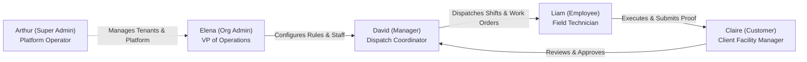
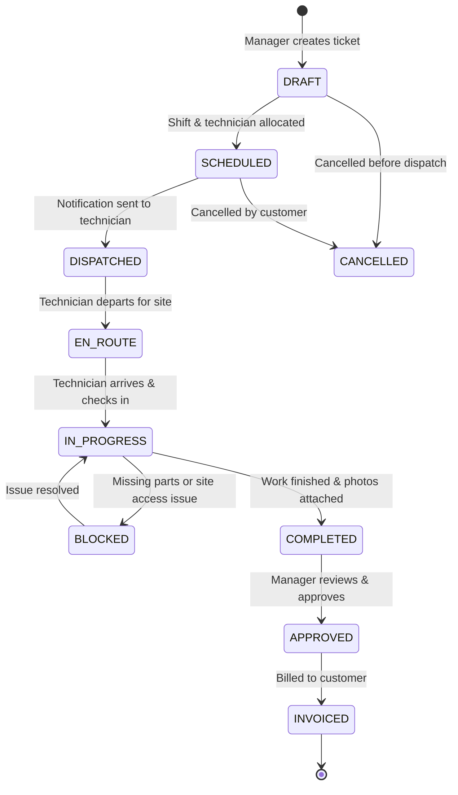
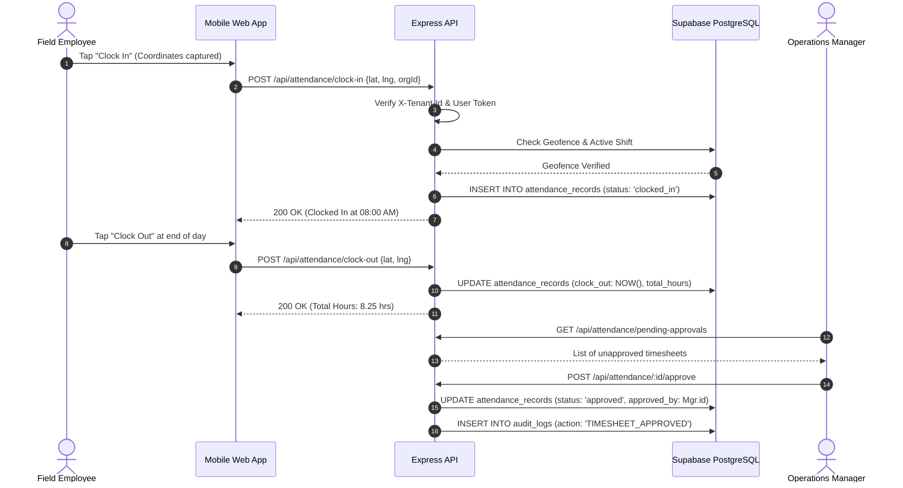
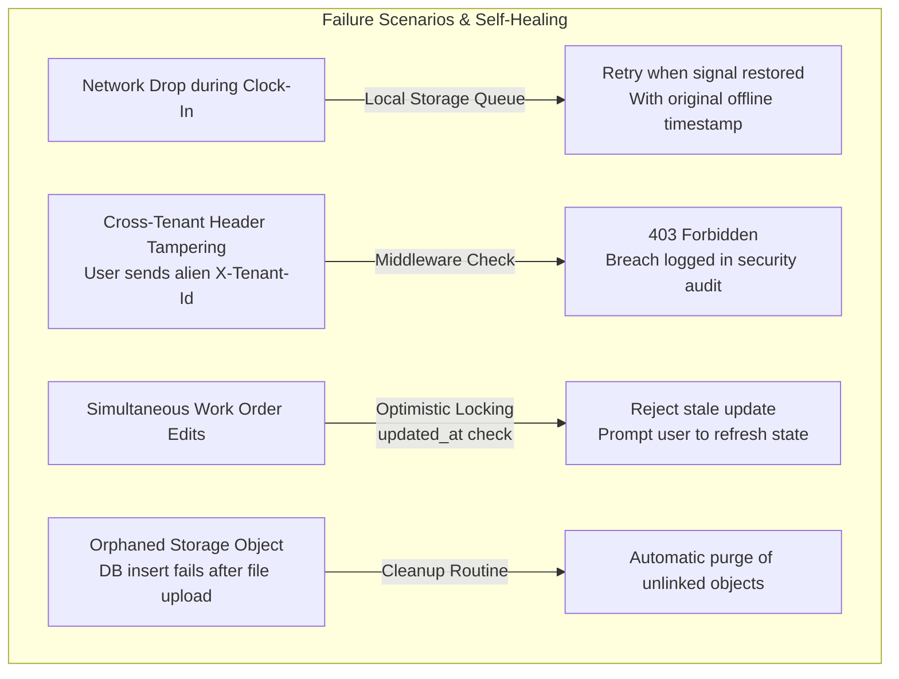

# OpsPilot — Product Requirement Document (PRD)

**Document Version:** 1.0.0  
**Status:** Approved for Implementation  
**Target Delivery Window:** 8–12 Weeks (Solo Developer / Rapid Delivery)  
**Authors:** Senior Product Manager & Enterprise Software Architect  
**Project:** OpsPilot — Multi-Tenant Enterprise Operations & Workforce Management SaaS  

---

## Table of Contents
1. [Product Vision and Objectives](#1-product-vision-and-objectives)
2. [Business Problems Being Solved](#2-business-problems-being-solved)
3. [Target Customers and Business Types](#3-target-customers-and-business-types)
4. [User Personas](#4-user-personas)
5. [User Roles and Privilege Boundaries](#5-user-roles-and-privilege-boundaries)
6. [Functional Requirements by Module](#6-functional-requirements-by-module)
7. [Non-Functional Requirements (NFRs)](#7-non-functional-requirements-nfrs)
8. [End-to-End User Journeys](#8-end-to-end-user-journeys)
9. [Business Workflows & State Machines](#9-business-workflows--state-machines)
10. [Comprehensive Permissions Matrix](#10-comprehensive-permissions-matrix)
11. [System Validation Rules](#11-system-validation-rules)
12. [Edge Cases and Failure Scenarios](#12-edge-cases-and-failure-scenarios)
13. [MVP Scope vs. Future Roadmap](#13-mvp-scope-vs-future-roadmap)
14. [Feature-by-Feature Acceptance Criteria (Given-When-Then)](#14-feature-by-feature-acceptance-criteria)

---

## 1. Product Vision and Objectives

### 1.1 Product Vision Statement
OpsPilot is an enterprise-grade, multi-tenant Operations & Workforce Management SaaS that unifies shift scheduling, field dispatch, asset tracking, mobile timekeeping, and customer service delivery into a single cohesive, high-performance platform. OpsPilot replaces fragmented spreadsheets, disconnected communication channels, and overpriced legacy enterprise software with a streamlined, modular system engineered for uncompromising tenant data isolation, operational velocity, and real-time visibility.

### 1.2 Core Objectives (North Star Goals)
* **Zero-Leakage Multi-Tenancy:** Enforce airtight organization-level isolation at both application and database layers using PostgreSQL Row Level Security (RLS) and contextual middleware.
* **Operational Friction Reduction:** Cut field operations dispatch and scheduling overhead by at least 65% through consolidated scheduling calendars and dispatch boards.
* **Proof-of-Performance Compliance:** Eliminate customer billing disputes via tamper-proof audit trails, geoverified clock-in records, and signed digital proof-of-work receipts.
* **Lean, High-Velocity Architecture:** Maintain a modular monolith architecture that a solo engineer can develop, test, debug, and deploy within 2–3 months while providing enterprise-grade security and maintainability.

---

## 2. Business Problems Being Solved

| Problem Domain | Legacy / Manual Status Quo | OpsPilot Solution |
|---|---|---|
| **Operational Blind Spots** | Dispatchers use WhatsApp, phone calls, and paper clipboards to manage field crews, causing lost work orders and missed appointments. | Centralized real-time dispatch dashboard with live work order statuses, technician assignments, and GPS check-ins. |
| **Schedule Chaos & Ghost Hours** | Manual timesheets and paper sign-in sheets lead to time fraud, unrecorded overtime, and conflicting shift assignments. | Automated shift scheduling with clash detection, mobile geofenced clock-in/out, and calculated billable hours. |
| **Data Leakage in Multi-Tenant Tools** | Off-the-shelf software often relies on soft filters in SQL queries (`WHERE org_id = x`), risking cross-tenant data leaks during code regressions. | Dual-tier defense-in-depth: Express tenant middleware checks membership, and Supabase PostgreSQL RLS mathematically guarantees isolation. |
| **Tool Sprawl & Prohibitive Costs** | Small-to-mid enterprise operators pay for 4–6 point solutions (scheduling app, field service app, document vault, time clock, invoicing add-on). | All-in-one modular monolith covering workforce, scheduling, dispatch, assets, documents, and audit logs. |
| **Dispute Resolution & Audit Deficiencies** | When a customer disputes whether a technician arrived or a maintenance task was completed, operators lack verifiable records. | Append-only immutable audit trail and customer-accessible proof-of-service vault with timestamped images and digital signatures. |

---

## 3. Target Customers and Business Types

OpsPilot is engineered specifically for mid-market and small-to-medium enterprise (SME) operations providers employing 10 to 500 field or shift workers across the following verticals:

1. **Commercial Field Service Providers:** HVAC technicians, commercial electricians, plumbing contractors, and elevator maintenance firms.
2. **Logistics & Fleet Transport:** Last-mile delivery fleets, freight dispatchers, courier networks, and localized distribution hubs.
3. **Facilities Management & Cleaning:** Commercial janitorial services, property maintenance teams, landscaping, and building inspection providers.
4. **Security & Guard Patrol Operations:** Physical security agencies requiring guard tour verification, shift handover tracking, and incident logging.
5. **Specialized Industrial Operations:** Field calibration technicians, telecom tower repair crews, and renewable energy (solar/wind) maintenance operators.

---

## 4. User Personas



### Persona 1: Elena Vance — VP of Operations (Organization Admin)
* **Demographics:** 44 years old, based in Chicago, oversees 85 technicians and 6 field supervisors.
* **Pain Points:** Spends hours cross-referencing timesheets with client invoices; terrified of data leaks; needs instant visibility into operational costs and margin per project.
* **Goals:** Onboard managers quickly, configure custom roles and pay rates, view organization-wide operational KPIs, and enforce company policies.

### Persona 2: David Miller — Operations Dispatch Coordinator (Manager)
* **Demographics:** 36 years old, operates from the central dispatch desk, handles 40–70 jobs daily.
* **Pain Points:** Phone rings continuously with status inquiries; struggles to track which technician has which vehicle/equipment; last-minute shift call-outs derail schedules.
* **Goals:** Visual drag-and-drop shift calendar, fast work-order dispatching, real-time worker availability, and instant re-assignment when emergencies happen.

### Persona 3: Liam Patel — Field Service Technician (Employee)
* **Demographics:** 29 years old, on the road 8 hours a day, uses an iOS/Android smartphone.
* **Pain Points:** Clunky software with 15 required clicks just to clock in; lost paper job tickets; having to drive back to the office to submit signed receipts.
* **Goals:** Clean mobile view showing today's assigned tasks, 1-tap clock-in/out, GPS route directions, and camera capture for completion photos and signatures.

### Persona 4: Claire Robinson — Client Operations Director (Customer)
* **Demographics:** 48 years old, manages 12 commercial properties serviced by Elena’s firm.
* **Pain Points:** Zero visibility into when contractors arrive; receives unexpected invoices with no breakdown of work performed.
* **Goals:** Self-service portal to request service, track live status of tickets, inspect photos of completed maintenance, and approve work digitally.

### Persona 5: Arthur Pendelton — Platform System Operator (Super Admin)
* **Demographics:** Senior DevOps/System Architect maintaining the OpsPilot SaaS instance.
* **Pain Points:** Tenant provisioning overhead; monitoring noisy tenant queries; ensuring database isolation across thousands of records.
* **Goals:** Platform health metrics, tenant lifecycle management (activate, suspend, tier upgrades), and automated backup/audit verification.

---

## 5. User Roles and Privilege Boundaries

OpsPilot enforces five strictly separated roles:

```
[Level 0: Super Admin] (Platform Scope)
         │
         ▼
[Level 1: Organization Admin] (Tenant Scope: Owner/Admin)
         │
         ├────────────────────────────────────────┐
         ▼                                        ▼
[Level 2: Manager] (Tenant Staff)        [Level 4: Customer] (Tenant Client)
         │                                        │
         ▼                                        │
[Level 3: Employee] (Field Staff)                │
         ▲                                        │
         └────────────────────────────────────────┘
```

1. **Super Admin (Platform Operator):**
   * **Scope:** Platform-wide (Cross-tenant administrative control).
   * **Capabilities:** Create/suspend organizations, adjust subscription tiers, view platform-wide health and resource metrics, inspect anonymized audit logs.
   * **Restrictions:** Cannot access tenant customer data unless explicitly in platform support mode with logged audit justification.
2. **Organization Admin (Tenant Owner / Admin):**
   * **Scope:** Single Tenant.
   * **Capabilities:** Full CRUD on organization profile, billing settings, user invitations, role assignments, department structures, rate cards, and integrations.
   * **Restrictions:** Completely isolated from any other organization's database records.
3. **Manager (Dispatch Coordinator / Team Lead):**
   * **Scope:** Single Tenant.
   * **Capabilities:** Create, edit, and assign shifts; create and dispatch work orders; allocate tools/assets; approve attendance records; view team performance.
   * **Restrictions:** Cannot edit organization billing, cannot delete organization, cannot modify owner/admin role privileges.
4. **Employee (Field Technician / Shift Worker):**
   * **Scope:** Single Tenant (Self-record restricted).
   * **Capabilities:** View personal shift calendar; clock in/out (with geolocation); update status of assigned work orders; upload task completion photos and notes.
   * **Restrictions:** Cannot view other employees' pay rates, cannot alter work order billable rates, cannot reassign shifts to peers.
5. **Customer (Client Portal User):**
   * **Scope:** Single Tenant (Customer-account restricted).
   * **Capabilities:** Submit service requests; view status of open tickets; view technician arrival estimations; inspect and sign off on completion receipts; download invoice PDFs.
   * **Restrictions:** Zero visibility into internal workforce roster, technician hourly rates, internal dispatch notes, or other customers' tickets.

---

## 6. Functional Requirements by Module

### 6.1 Module 1: Multi-Tenant Core & Identity Management
* **FR-1.1 Organization Provisioning:** System shall support organization creation with unique company name, URL slug (`/app/:slug` or header-based), and default subscription tier (`starter`, `growth`, `enterprise`).
* **FR-1.2 Dual-Tier Isolation:** All API routes must enforce active tenant context via `X-Tenant-Id` header and user membership check. The database must enforce isolation via PostgreSQL RLS policies.
* **FR-1.3 Authentication:** User authentication powered by Supabase Auth (Email + Password, Magic Link, and Session Refresh). Session tokens stored securely with automatic expiration and refresh cycles.
* **FR-1.4 Tenant Switching:** Users belonging to multiple organizations (e.g. consultants or contractor technicians) can switch active tenant workspaces without re-authenticating.

### 6.2 Module 2: Role-Based Access Control (RBAC) & Membership
* **FR-2.1 Member Invitations:** Admins can invite users via email with a cryptographic invitation token, designated role, and assigned department.
* **FR-2.2 Role Assignment:** Admins can promote/demote members between Admin, Manager, and Employee roles. The primary Owner role cannot be demoted unless transferred.
* **FR-2.3 Membership Suspension:** Deactivating a member immediately revokes their active session and blocks all tenant-scoped API requests.

### 6.3 Module 3: Workforce Directory & Profile Management
* **FR-3.1 Staff Roster:** Maintain detailed employee directory including full name, unique employee ID (`EMP-XXXX`), corporate email, mobile phone, department, job title, and employment type (`full_time`, `part_time`, `contract`, `intern`).
* **FR-3.2 Skills & Certifications:** Record technical competencies (e.g., "EPA Universal Certified", "High-Voltage Level 2", "Heavy Crane Class A") with expiration dates.
* **FR-3.3 Hourly Rate Tracking:** Store standard and overtime billable/cost rates per worker with access restricted strictly to Admins and authorized Managers.

### 6.4 Module 4: Shift Scheduling & Time Attendance
* **FR-4.1 Shift Planner:** Visual calendar/gantt interface to schedule shifts by date, time window, department, location, and assigned personnel.
* **FR-4.2 Conflict Detection:** Automatically detect and warn dispatchers of double-booking, rest period violations (< 8 hours between shifts), or expired certification conflicts.
* **FR-4.3 Geofenced Clock-In/Out:** Mobile clock-in/out capturing exact timestamp, GPS coordinates (latitude, longitude), and proximity verification against job site geofence.
* **FR-4.4 Timesheet Approvals:** Managers can review clock-in logs, make audited manual adjustments with reason codes, and approve timesheets for payroll export.

### 6.5 Module 5: Field Operations & Work Order Dispatch
* **FR-5.1 Work Order Management:** Create work orders containing title, description, priority (`low`, `medium`, `high`, `urgent`), customer account, service location, and target SLA deadline.
* **FR-5.2 Dispatch & Assignment:** Assign single or multiple technicians and designated equipment to work orders with automated email/in-app notification.
* **FR-5.3 Status State Machine:** Strict transitions: `DRAFT` $\to$ `SCHEDULED` $\to$ `DISPATCHED` $\to$ `EN_ROUTE` $\to$ `IN_PROGRESS` $\to$ `COMPLETED` $\to$ `APPROVED` $\to$ `INVOICED`.
* **FR-5.4 Digital Proof-of-Work:** Field workers attach completion notes, before/after photographs, parts consumed, and capture client digital signature directly on glass.

### 6.6 Module 6: Asset & Equipment Registry
* **FR-6.1 Asset Tracking:** Registry of company vehicles, diagnostic tools, and heavy machinery with serial number, purchase date, asset tag, and current status (`available`, `assigned`, `maintenance`, `retired`).
* **FR-6.2 Asset Checkout:** Link assets to work orders or specific technicians. Prevent overlapping allocation of high-demand machinery.
* **FR-6.3 Maintenance Logs:** Record scheduled service intervals, meter/mileage readings, and repair expenses.

### 6.7 Module 7: Multi-Tenant Document Vault (Supabase Storage)
* **FR-7.1 Isolated Storage Buckets:** Storage structure partitioned strictly by tenant UUID: `/{organization_id}/documents/{category}/{file_id}`.
* **FR-7.2 Categorized Vault:** Support categories: `compliance_certs`, `work_order_media`, `customer_agreements`, and `safety_checklists`.
* **FR-7.3 Time-Limited Signed URLs:** Sensitive documents (contracts, compliance proofs) accessed only via ephemeral signed download URLs (5–15 minute TTL).

### 6.8 Module 8: Customer Self-Service Portal
* **FR-8.1 Ticket Submission:** External customers log in to submit service tickets, designate urgency, upload site images, and specify access hours.
* **FR-8.2 Live Progress Tracker:** Read-only milestone tracking of open service tickets (e.g. "Technician En Route", "Work in Progress").
* **FR-8.3 Digital Receipt Vault:** Customers can review and download signed work completion certificates and itemized parts/labor summaries.

### 6.9 Module 9: Enterprise Audit Logging & Analytics
* **FR-9.1 Append-Only Audit Stream:** Immutable recording of all data mutations: timestamp, user UUID, tenant UUID, action (`CREATE`, `UPDATE`, `DELETE`, `LOGIN`, `STATUS_CHANGE`), entity type, entity ID, previous state snapshot, and new state snapshot.
* **FR-9.2 Operational KPI Metrics:** Real-time metrics: on-time arrival rate, first-time fix rate, total billable hours, active workforce ratio, and SLA breach warnings.
* **FR-9.3 Compliance Data Export:** Filter and export audit logs, timesheets, and work orders to CSV and printable PDF formats.

---

## 7. Non-Functional Requirements (NFRs)

### 7.1 Security & Compliance
* **Zero Service-Role Exposure:** Under no circumstances shall `SUPABASE_SERVICE_ROLE_KEY` be bundled or exposed to client-side code. The frontend interacts strictly with `VITE_SUPABASE_ANON_KEY` or the authenticated Express API.
* **Dual-Tier RLS Enforcement:** Every tenant-scoped PostgreSQL table must have `ROW LEVEL SECURITY` enabled with policies checking `is_member_of(organization_id)`.
* **Data Sanitization & Injection Defense:** All incoming HTTP payloads validated using `Zod` schemas. Parameterized database queries prevent SQL injection.
* **Security Headers & CORS:** Helmet security headers enabled (`X-Content-Type-Options: nosniff`, `X-Frame-Options: DENY`, strict Content Security Policy). CORS restricted to explicit allowed origins.

### 7.2 Performance & Responsiveness
* **API Response Latency:** 95% of API requests (`p95`) must respond in $< 200\text{ ms}$ under normal operational load.
* **Client Initial Load:** Vite React production bundle $< 500\text{ KB}$ gzipped; First Contentful Paint (FCP) $< 1.2\text{ s}$ on standard broadband.
* **Database Optimization:** Composite indexes placed on `(organization_id, created_at DESC)`, `(organization_id, status)`, and `(organization_id, employee_code)`.

### 7.3 Availability & Reliability
* **Target System Uptime:** 99.9% monthly availability for core dispatch and clock-in endpoints.
* **Graceful Degradation:** When offline or during transient cellular disconnects, mobile UI preserves local draft notes and warns the technician cleanly.

### 7.4 Usability & Accessibility
* **Responsive Layout:** 100% functional on desktop monitors (1920x1080), laptop screens (1366x768), tablets, and mobile devices (375px+).
* **High-Contrast Dark & Light Mode:** Tailored enterprise color palette compliant with WCAG 2.1 Level AA contrast standards.
* **One-Click QA Persona Switcher:** Built-in development mode simulator allowing instant switching between Owner, Manager, and Employee for rapid verification.

---

## 8. End-to-End User Journeys

### Journey A: Organization Admin Setup & Onboarding
1. **Sign Up:** Elena Vance navigates to `/login`, registers with corporate email, and confirms email verification link.
2. **Organization Creation:** Prompted by the Onboarding Wizard to enter company name ("Acme Logistics Global"), custom slug (`acme-logistics`), and select tier ("Enterprise").
3. **Workspace Configuration:** Defines initial departments ("Fleet Operations", "HVAC Operations", "Warehouse Logistics").
4. **Team Invitation:** Invites David Miller as "Manager" and Liam Patel as "Employee" via email.
5. **Rate Setup:** Configures default billing and overtime rules in Organization Settings.

### Journey B: Manager Scheduling & Work Order Dispatch
1. **Job Ingestion:** David Miller receives an urgent customer maintenance ticket from Claire Robinson.
2. **Work Order Creation:** David creates Work Order `WO-8492` ("Emergency Chiller Repair - Site Alpha"), sets priority to `URGENT`, and attaches equipment asset `CHILLER-01`.
3. **Technician Assignment:** Reviews shift calendar; filters by certified HVAC technicians; selects Liam Patel.
4. **Dispatch:** Changes status from `DRAFT` to `DISPATCHED`. Liam receives instant push/in-app notification.

### Journey C: Field Technician Mobile Execution
1. **Shift Start:** Liam arrives at job site, opens OpsPilot on smartphone, and taps "Clock In". Geolocation verifies he is within 50 meters of the site.
2. **Work Order Acceptance:** Views `WO-8492`, taps "En Route", then taps "Start Job" upon arrival. Status updates to `IN_PROGRESS`.
3. **Task Completion:** Liam performs repair, records parts used (1x Compressor Valve), and uploads 2 high-resolution photos into the Document Vault.
4. **Customer Sign-Off:** Liam hands phone to site contact; customer signs digital touch canvas.
5. **Completion:** Liam taps "Complete Work Order" and clocks out.

### Journey D: Customer Service Verification & Sign-Off
1. **Ticket Tracking:** Claire logs into the Customer Portal, viewing live progress of `WO-8492`.
2. **Completion Inspection:** Receives notification of job completion; reviews technician before/after photos and parts checklist.
3. **Receipt Download:** Downloads digitally signed Work Order Completion PDF for property management accounting.

---

## 9. Business Workflows & State Machines

### 9.1 Work Order State Machine



### 9.2 Time Attendance & Shift Approval Workflow



---

## 10. Comprehensive Permissions Matrix

| Module & Action | Super Admin | Org Admin | Manager | Employee | Customer |
|---|:---:|:---:|:---:|:---:|:---:|
| **Platform Tenant Provisioning** | ✅ | ❌ | ❌ | ❌ | ❌ |
| **Manage Subscription Tier** | ✅ | ✅ | ❌ | ❌ | ❌ |
| **Invite & Deactivate Org Users** | ❌ (Global Only) | ✅ | ❌ | ❌ | ❌ |
| **View Organization Roster & Salaries** | ❌ | ✅ | ✅ (No salary) | ❌ | ❌ |
| **Create & Edit Shifts** | ❌ | ✅ | ✅ | ❌ | ❌ |
| **View Personal Schedule** | ❌ | ✅ | ✅ | ✅ | ❌ |
| **Clock In / Out (Mobile GPS)** | ❌ | ❌ | ❌ | ✅ | ❌ |
| **Approve Timesheets** | ❌ | ✅ | ✅ | ❌ | ❌ |
| **Create & Dispatch Work Orders** | ❌ | ✅ | ✅ | ❌ | ❌ |
| **Update Work Order Status (Field)**| ❌ | ✅ | ✅ | ✅ (Assigned only) | ❌ |
| **Submit Customer Service Ticket** | ❌ | ❌ | ❌ | ❌ | ✅ |
| **Sign Proof-of-Work Receipt** | ❌ | ❌ | ❌ | ❌ | ✅ |
| **Checkout / Assign Assets** | ❌ | ✅ | ✅ | ❌ | ❌ |
| **Upload Compliance Documents** | ❌ | ✅ | ✅ | ✅ (Task docs) | ❌ |
| **View Immutable Audit Logs** | ✅ (Platform) | ✅ (Tenant) | ✅ (Read-only) | ❌ | ❌ |
| **Export Data to CSV / PDF** | ✅ | ✅ | ✅ | ❌ | ✅ (Receipts only) |

---

## 11. System Validation Rules

1. **Organization Validation:**
   * `name`: String, 2–100 characters, required.
   * `slug`: Lowercase alphanumeric with hyphens only (`^[a-z0-9-]+$`), 2–50 characters, globally unique.
   * `subscription_tier`: Must be one of `['starter', 'growth', 'enterprise']`.
2. **Employee Profile Validation:**
   * `employee_code`: Uppercase alphanumeric (`^[A-Z0-9-]+$`), unique per organization.
   * `email`: Standard RFC 5322 format, unique across users.
   * `hourly_rate`: Non-negative decimal (`>= 0.00`).
3. **Shift Validation:**
   * `end_time` must be chronologically after `start_time`.
   * A worker cannot be assigned to overlapping shifts within the same time window.
   * Maximum shift duration cannot exceed 16 consecutive hours without an automated fatigue alert.
4. **Work Order Validation:**
   * Target SLA deadline must be in the future when creating a new ticket.
   * Transition from `IN_PROGRESS` to `COMPLETED` requires at least one attachment or completion note.
   * Reopening a `COMPLETED` order requires Manager role or higher with mandatory audit reason.
5. **Storage & File Upload Validation:**
   * Allowed file types: `image/jpeg`, `image/png`, `image/webp`, `application/pdf`. Executables (`.exe`, `.bat`, `.sh`) strictly rejected.
   * Max upload file size: 10MB per image, 25MB per PDF document.

---

## 12. Edge Cases and Failure Scenarios



### 12.1 Network Connectivity Loss during Mobile Operations
* **Scenario:** Technician taps "Complete Job" or "Clock In" in a basement with zero cellular service.
* **Mitigation:** Mobile web client queues action in local indexed storage (`localStorage`/`IndexedDB`) with client timestamp. When network ping succeeds, queued actions replay automatically with verifiable timestamps.

### 12.2 Cross-Tenant Boundary Tampering
* **Scenario:** Malicious user manually alters the `X-Tenant-Id` header to access a competing tenant's data.
* **Mitigation:** Dual-tier trap:
  1. `tenantMiddleware` checks `organization_members` for the authenticated `req.user.id`. Fails with `403 FORBIDDEN_CROSS_TENANT_ACCESS`.
  2. Database RLS queries `is_member_of(organization_id)` using JWT `auth.uid()`, mathematically preventing the query from returning rows.
  3. Security incident recorded in `audit_logs` with offending IP, user ID, and target organization ID.

### 12.3 Concurrent Edits on Single Work Order
* **Scenario:** Manager reassigns a work order while the field technician is updating status to `COMPLETED`.
* **Mitigation:** Optimistic concurrency control via `updated_at` timestamp comparison. If record version differs, return HTTP `409 Conflict` with latest entity payload so the client can resolve cleanly.

### 12.4 Tenant Subscription Suspension Mid-Session
* **Scenario:** An organization is suspended for non-payment while 20 technicians are active in the field.
* **Mitigation:** Subsequent API calls check `organization.is_active`. If false, respond with `402 Payment Required` or `403 Tenant Suspended`. The frontend intercepts this and displays a polite locked-workspace banner while preserving local unsaved drafts.

---

## 13. MVP Scope vs. Future Roadmap

To ensure realistic, high-quality execution by a solo developer within 2–3 months, the system scope is partitioned into rigorous phases:

```
Month 1: Core Foundation & Identity (Milestones 1 & 2 & 3)
Month 2: Scheduling, Dispatch & Assets (Milestones 4 & 5 & 6)
Month 3: Customer Portal, Audit Trails & Hardening (Milestones 7 & 8)
```

### 13.1 MVP Scope (Months 1–3)
* **Core Foundation:** Multi-tenant modular monolith, dual-tier PostgreSQL RLS, Express middleware.
* **Identity & Access:** Supabase Auth, organization onboarding, 5 core roles, invite system.
* **Workforce Directory:** Staff roster, departments, contact info, hourly rates.
* **Shift Scheduling:** Calendar view, shift assignment, double-booking prevention.
* **Mobile Attendance:** Geofenced clock-in/out, hours tracking, timesheet approval.
* **Work Order Dispatch:** Work order lifecycle state machine, technician dispatch, completion notes.
* **Document Vault:** Supabase Storage bucket with multi-tenant directory partitioning.
* **Audit Trail & Dashboard:** Operational KPI cards, immutable audit log view, CSV export.

### 13.2 Post-MVP / Future Enhancements (Roadmap)
* **AI Route Optimization:** Automated dispatch ordering based on real-time traffic and distance matrices.
* **Native Offline-First PWA:** Native service worker background synchronization with IndexedDB and push notifications.
* **Automated QuickBooks / Stripe Invoicing:** Direct two-way sync converting approved work orders into accounting invoices.
* **IoT Telematics Integration:** Automated vehicle OBD-II GPS tracking and engine fault code ingestion.

---

## 14. Feature-by-Feature Acceptance Criteria

### 14.1 Tenant Onboarding & Workspace Isolation
* **Scenario:** User provisions a new organization workspace.
  * **Given** an authenticated user who is not yet associated with an organization,
  * **When** they complete the onboarding form with Name: `"Apex Logistics"` and Slug: `"apex-logistics"`,
  * **Then** an organization record is created in `public.organizations`, the user is mapped as `owner` in `public.organization_members`, and the session context switches to the new tenant.
* **Scenario:** Cross-tenant API request rejection.
  * **Given** User A authenticated in Organization X,
  * **When** User A issues `GET /api/workforce` with header `X-Tenant-Id: <Org Y>`,
  * **Then** the server responds with `403 Forbidden`, code `FORBIDDEN_CROSS_TENANT_ACCESS`, and zero records are disclosed.

### 14.2 Workforce Directory Management
* **Scenario:** Manager adds a new field technician.
  * **Given** an authenticated user with role `manager` or `admin`,
  * **When** they submit a valid workforce member form with unique `employee_code: "EMP-104"`,
  * **Then** the employee record is created, attached strictly to the active `organization_id`, and immediately visible in the directory table.

### 14.3 Shift Scheduling & Conflict Prevention
* **Scenario:** Dispatcher attempts to schedule a worker on overlapping shifts.
  * **Given** Technician Liam Patel is scheduled on `Shift A` from 08:00 to 16:00,
  * **When** a dispatcher attempts to assign Liam to `Shift B` on the same day from 14:00 to 20:00,
  * **Then** the system rejects the creation with `400 Bad Request`, code `SHIFT_SCHEDULE_CONFLICT`, and highlights the overlapping 2-hour window on the calendar.

### 14.4 Mobile Geofenced Clock-In
* **Scenario:** Technician clocks in outside the job site geofence.
  * **Given** Work Order location with 100-meter radius geofence,
  * **When** Technician attempts clock-in with GPS coordinates 800 meters away,
  * **Then** the system records the clock-in but flags it with status `GEOFENCE_WARNING`, requiring Manager review before payroll sign-off.

### 14.5 Work Order Dispatch & Customer Sign-Off
* **Scenario:** Field technician completes work order.
  * **Given** a work order in `IN_PROGRESS` status,
  * **When** the technician uploads at least one photo, inputs notes, and captures customer signature,
  * **Then** the work order transitions to `COMPLETED`, customer receives receipt notification, and an immutable log entry is generated in `audit_logs`.

---

**End of Product Requirement Document (PRD)**  
*Next Phase: Technical Architecture & Milestone Implementation.*
