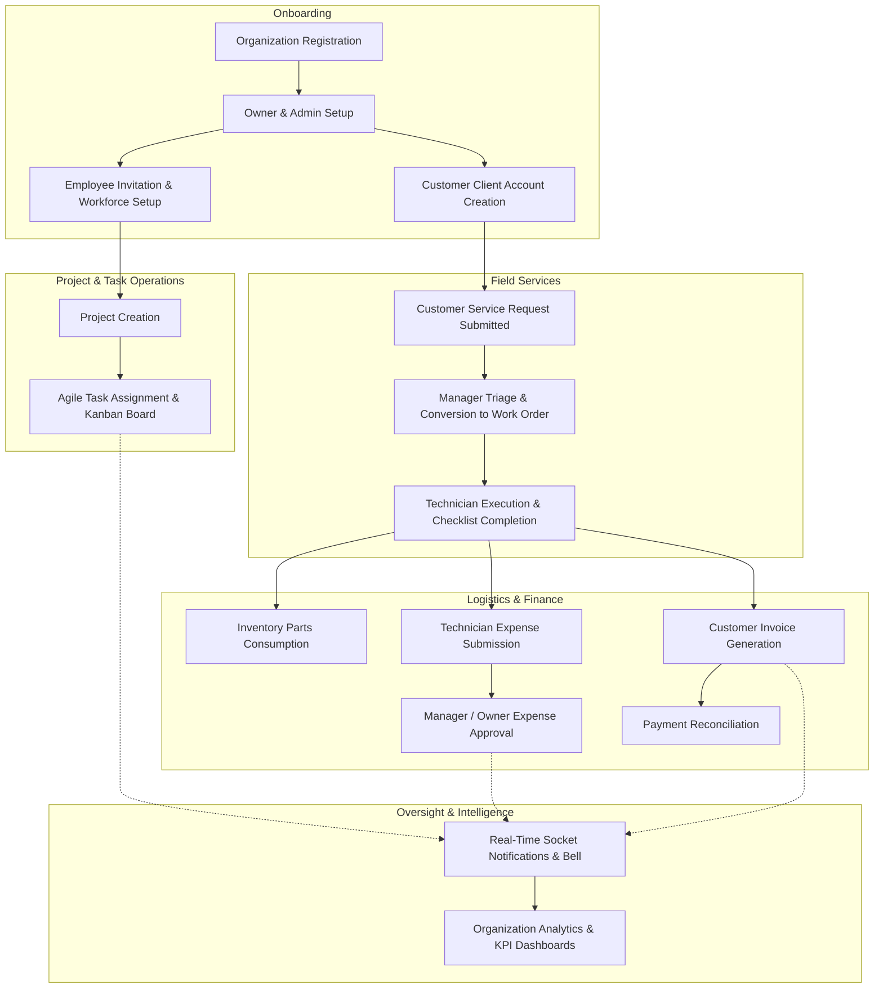

# OpsPilot End-to-End Business Workflow Guide

This guide walks through every core business operational lifecycle in **OpsPilot**, detailing how data moves through the platform, which API endpoints are called, which UI views are involved, and how tenant isolation and role permissions are enforced.

---

## 1. Quick Testing Personas & Pre-Seeded Accounts

For local development and testing, OpsPilot includes pre-configured personas accessible directly via the **1-Click Persona Bar** on the Login page (`http://localhost:5173/login`):

| Persona Name | Role | Primary Tenant | Email | Primary Responsibilities |
| :--- | :--- | :--- | :--- | :--- |
| **Alex Rivera** | `owner` | Acme Logistics Global | `alex.rivera@acmelogistics.com` | Full organization governance, finances, subscriptions, company settings |
| **Sarah Chen** | `admin` | Acme Logistics Global | `sarah.chen@acmelogistics.com` | Operations administration, user onboarding, role management |
| **Marcus Vance** | `manager` | Acme Logistics Global | `marcus.vance@acmelogistics.com` | Team productivity, project assignment, expense approvals, service triage |
| **David Kim** | `employee` / `technician` | Acme Logistics Global | `david.kim@acmelogistics.com` | Field work execution, checklist updates, task movement, expense filing |
| **Olivia Parker** | `customer` | Apex Enterprises *(Customer Portal)* | `olivia.parker@apexenterprises.com` | External customer ticket creation, invoice viewing, service requests |
| **Elena Rostova** | `superadmin` | Global Platform | `elena.rostova@opspilot.internal` | Platform health, multi-tenant subscription tier controls, global metrics |

---

## 2. Core Business Workflows

---

### Workflow 1: Organization Registration & Tenant Initialization

1. **User Action:** A new tenant navigates to `/register` and provides:
   - Company Name (e.g. `"Nexus Industrial"`)
   - Company Slug (e.g. `"nexus-industrial"`)
   - Owner Full Name, Work Email, and Password.
2. **API Endpoint:** `POST /api/v1/organizations/register`
3. **Backend Processing:**
   - Validates uniqueness of organization slug.
   - Creates entry in `organizations` table.
   - Enforces default tier (`starter` or `trial`).
   - Automatically provisions default company departments (Operations, Field Service, Engineering, Finance).
   - Seeds system RBAC roles (`owner`, `admin`, `manager`, `employee`, `technician`, `customer`).
   - Creates the owner user record with role `owner` in `organization_members`.
   - Issues a tenant-scoped session JWT.
4. **Result:** The user is immediately redirected to the root `/` dashboard under their new isolated tenant context.

---

### Workflow 2: Admin Onboarding & Workforce Invitation

1. **User Action:** Logged in as **Alex Rivera** or **Sarah Chen**, navigate to **Workforce** (`/workforce`).
2. **Invite Member:** Click **"Invite Employee"**, providing:
   - Full Name, Email, Department, Job Title, Hourly Cost Rate, and Role (`manager`, `employee`, or `technician`).
3. **API Endpoint:** `POST /api/v1/workforce/invite` (or `POST /api/v1/workforce`)
4. **Security Enforcement:**
   - Validates that the active tenant has not exceeded its plan `member_limit`.
   - The invited member is scoped strictly to `organization_id`.
   - Role escalation guard prevents assigning `superadmin`.
5. **Real-time Event:** Emits `workforce:member_added` via Socket.IO to the organization room `org:<org_id>`.

---

### Workflow 3: Customer Creation & Portal Linking

1. **User Action:** From **Customers** (`/customers`), click **"Add Customer"**.
2. **Provide Details:**
   - Company Name (e.g. `"Apex Enterprises"`)
   - Contact Person, Email, Phone, Address, SLA Tier (`bronze`, `silver`, `gold`, `platinum`).
3. **API Endpoint:** `POST /api/v1/customers`
4. **Customer Portal Redirection:** When an external user logs in with role `customer` (such as **Olivia Parker**), the frontend router automatically redirects them to `/portal`, locking down internal operational tabs and exposing only customer-facing tickets and invoices.

---

### Workflow 4: Project Creation & Agile Kanban Task Management

1. **Create Project:** Navigate to **Projects** (`/projects`), click **"New Project"**:
   - Provide Title, Description, Client link, Target Completion Date, and Budget.
   - **API Endpoint:** `POST /api/v1/projects`
2. **Assign Tasks:** Inside the project, navigate to **Kanban Board** (`/tasks` or `/projects/:id/tasks`):
   - Add task: Title, Description, Priority (`low`, `medium`, `high`, `urgent`), Due Date, and Assignee.
   - **API Endpoint:** `POST /api/v1/tasks`
3. **Interactive Kanban Drag & Column Update:**
   - Dragging a task across columns (`backlog` $\rightarrow$ `todo` $\rightarrow$ `in_progress` $\rightarrow$ `review` $\rightarrow$ `done`) triggers:
   - **API Endpoint:** `PATCH /api/v1/tasks/:id/column` or `PATCH /api/v1/tasks/:id`
4. **Real-time Broadcast:** Socket.IO fires `task:status_changed` and `task:assigned`, updating all connected team members' screens instantly.

---

### Workflow 5: Customer Service Request to Work Order Lifecycle

1. **Ticket Submission:** Customer (**Olivia Parker**) logs in at `/portal` and clicks **"Submit Request"**:
   - Title: *"HVAC Compressor High-Pressure Fault"*
   - Category: *"Maintenance"*, Urgency: *"High"*, Description: *"Unit 4B vibrating excessively"*.
   - **API Endpoint:** `POST /api/v1/service-requests`
2. **Manager Triage:** Operations Manager (**Marcus Vance**) views the ticket in `/service-requests`:
   - Changes status from `submitted` to `acknowledged`.
   - Clicks **"Convert to Work Order"**.
   - **API Endpoint:** `POST /api/v1/service-requests/:id/convert-to-work-order`
3. **Work Order Execution:** Field Technician (**David Kim**) sees the assigned order in `/work-orders`:
   - Inspects scheduled start time, priority, and required skills.
   - Checks off items in the dynamic safety checklist.
   - Changes status: `scheduled` $\rightarrow$ `in_progress` $\rightarrow$ `completed`.
   - **API Endpoint:** `PATCH /api/v1/work-orders/:id/status`

---

### Workflow 6: Inventory Management & Parts Consumption

1. **Inventory Catalog:** Navigate to **Inventory** (`/inventory`):
   - Displays all SKU items, warehouse locations, stock levels, and `reorder_level` thresholds.
   - **API Endpoint:** `GET /api/v1/inventory`
2. **Stock Consumption / Adjustment:**
   - When parts are used on a Work Order, adjust stock:
   - **API Endpoint:** `POST /api/v1/inventory/:id/adjust` with payload `{ quantity_change: -2, reason: "Consumed on WO-2026-081" }`
3. **Automated Low-Stock Trigger:**
   - If stock falls below `reorder_level`, background automation fires `inventory:low_stock` alert and notifies managers.

---

### Workflow 7: Expense Submission & Approval Workflow

1. **Submission:** Employee / Technician (**David Kim**) incurs a field travel or parts expense:
   - Navigates to **Expenses** (`/expenses`), clicks **"Submit Expense"**.
   - Fields: Category, Amount, Currency, Description, Date, Receipt upload attachment.
   - **API Endpoint:** `POST /api/v1/expenses`
   - Initial status: `pending`.
2. **Approval / Rejection:** Manager (**Marcus Vance**) or Owner (**Alex Rivera**):
   - Receives notification: *"New expense pending approval"*.
   - Navigates to `/expenses`, reviews receipt and amount.
   - Clicks **"Approve"** (`PATCH /api/v1/expenses/:id/approve`) or **"Reject"** (`PATCH /api/v1/expenses/:id/reject`).
   - Audit log record is automatically committed with approver's user ID and timestamp.

---

### Workflow 8: Customer Invoicing & Payment Reconciliation

1. **Invoice Generation:** Finance team or Owner creates customer invoice in **Finance** (`/invoices`):
   - Selects Customer, Invoice Due Date, and line items (labor hours, parts consumed, tax rate).
   - **API Endpoint:** `POST /api/v1/invoices`
   - Generates sequential invoice number (e.g. `INV-2026-0042`).
2. **Customer View:** Customer (**Olivia Parker**) views invoice in customer portal `/portal/invoices`.
3. **Record Payment:**
   - When payment is received, record payment:
   - **API Endpoint:** `POST /api/v1/invoices/:id/payments`
   - Backend automatically updates `paid_amount`, calculates remaining `balance`, and transitions status from `issued` $\rightarrow$ `partially_paid` $\rightarrow$ `paid`.

---

### Workflow 9: Real-Time Notifications & Socket.IO Engine

1. **Authenticated Handshake:** Client establishes WebSocket connection to `/socket.io` with Bearer token and `X-Tenant-Id`.
2. **Room Membership:** Server validates JWT and joins the client strictly to:
   - Organization room: `org:<org_id>`
   - User private room: `user:<user_id>`
3. **Notifications:**
   - In-app notification bell polls/subscribes to updates.
   - Mark as read: `PATCH /api/v1/notifications/:id/read`
   - Mark all read: `POST /api/v1/notifications/read-all`

---

### Workflow 10: Business Intelligence & Analytics Dashboards

1. **Organization Executive View:** (`/analytics` or `/`)
   - Total Workforce, Active Projects, Overdue Tasks, Invoiced vs Paid revenue, Expense burn rate.
   - **API Endpoint:** `GET /api/v1/analytics/organization`
2. **Manager Operational View:**
   - Team workload distribution, task completion velocity, work order turnaround.
   - **API Endpoint:** `GET /api/v1/analytics/manager`
3. **Super Admin Platform View:**
   - Total registered tenants, cross-tenant system metrics, storage consumption.
   - **API Endpoint:** `GET /api/v1/analytics/superadmin`

---

## 3. Implementation Status: Verified vs Simulated Features

To ensure transparency, the operational maturity of each feature is classified below:

| Feature Area | Status | Implementation Details |
| :--- | :--- | :--- |
| **Authentication & RBAC** | ✅ **Verified Working** | Multi-tenant JWT auth, password validation, role guards (Owner, Admin, Manager, Employee, Customer). |
| **Workforce & Customers** | ✅ **Verified Working** | Full CRUD, employee invitations, customer SLA tiers, portal redirection. |
| **Projects & Kanban Tasks** | ✅ **Verified Working** | Agile Kanban board, drag-and-drop, priority tags, real-time sync. |
| **Service Requests & Work Orders** | ✅ **Verified Working** | Ticket creation, manager triage, work order conversion, checklist verification. |
| **Inventory & Stock Adjustments** | ✅ **Verified Working** | SKU tracking, reorder thresholds, audit logging on quantity changes. |
| **Expenses & Invoices** | ✅ **Verified Working** | Line item calculations, approval/rejection state machine, payment reconciliation. |
| **Socket.IO Real-Time Engine** | ✅ **Verified Working** | Organization/user rooms, sliding-window deduplication, cross-tenant isolation. |
| **Background Automations** | ✅ **Verified Working** | BullMQ queue with in-memory fallback, cron scheduler for overdue tasks & stock. |
| **Subscription Management** | ⚠️ **Simulated State** | Subscription plans, limits, and upgrades are fully enforced in backend logic with simulated billing records (no live Stripe/LemonSqueezy charge calls). |
| **AI Business Assistant** | ℹ️ **Optional / Fallback** | Natural-language query interface with read-only analytics tools. Uses external Gemini/OpenAI API when keys are present; falls back to structured heuristic answers when keys are unset. |
