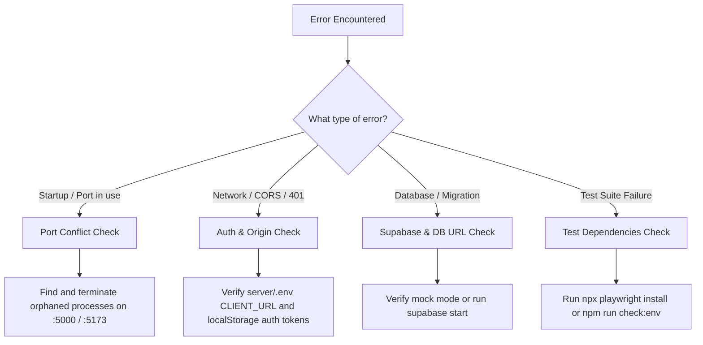

# OpsPilot Local Development & Operational Troubleshooting

This document addresses common errors, port conflicts, configuration gotchas, and environment discrepancies encountered when running or testing **OpsPilot** locally, along with step-by-step diagnostic and remediation procedures.

---

## 1. Quick Diagnostic Flowchart



---

## 2. Common Issues & Solutions

### Issue 1: Port Already In Use (`EADDRINUSE: :::5000` or `:5173`)

**Symptoms:**
- Server crashes on boot with: `Error: listen EADDRINUSE: address already in use :::5000`
- Vite prints: `Port 5173 is in use, trying another port 5174...`

**Root Cause:**
A previous instance of Node.js, nodemon, or Vite was not cleanly terminated and is still occupying the port.

**Solution:**

*On Windows (PowerShell):*
```powershell
# Terminate process occupying port 5000:
Get-Process -Id (Get-NetTCPConnection -LocalPort 5000).OwningProcess -ErrorAction SilentlyContinue | Stop-Process -Force

# Terminate process occupying port 5173:
Get-Process -Id (Get-NetTCPConnection -LocalPort 5173).OwningProcess -ErrorAction SilentlyContinue | Stop-Process -Force
```

*On Linux / macOS (Bash):*
```bash
# Terminate process on port 5000:
lsof -ti:5000 | xargs kill -9 2>/dev/null || true

# Terminate process on port 5173:
lsof -ti:5173 | xargs kill -9 2>/dev/null || true
```

---

### Issue 2: CORS Blocked in Browser Console

**Symptoms:**
Browser console displays:
```text
Access to XMLHttpRequest at 'http://localhost:5000/api/v1/...' from origin 'http://localhost:5173'
has been blocked by CORS policy: No 'Access-Control-Allow-Origin' header is present on the requested resource.
```

**Root Cause:**
The backend `CLIENT_URL` environment variable does not match the exact protocol, hostname, or port where the frontend Vite dev server is serving.

**Solution:**
1. Open `server/.env` and verify:
   ```env
   CLIENT_URL=http://localhost:5173
   ```
2. If running the client on a different port (e.g. `5174` due to port conflict), update `CLIENT_URL` in `server/.env`:
   ```env
   CLIENT_URL=http://localhost:5174
   ```
3. Restart the backend server (`npm run dev`).

---

### Issue 3: Socket.IO Connection Dropping or Handshake 401

**Symptoms:**
Frontend console shows recurring errors:
```text
[SocketContext] WebSocket connection to 'ws://localhost:5000/socket.io/?...' failed
Error: Authentication error: Missing or invalid authorization token
```

**Root Cause:**
Socket.IO requires an authenticated session with a valid JWT token and an active `organizationId`. If the browser's `localStorage` has expired tokens or empty tenant keys, the handshake is rejected.

**Solution:**
1. In your browser at `http://localhost:5173`, open Developer Tools (`F12`) $\rightarrow$ **Application** $\rightarrow$ **Local Storage**.
2. Clear the keys `opspilot_auth_token` and `opspilot_active_tenant_id`.
3. Navigate to `http://localhost:5173/login`.
4. Click **"Alex Rivera - Owner"** on the 1-Click Persona Bar.
5. This freshly establishes both token and organization ID in `localStorage`, and the Socket.IO connection will immediately succeed (`isConnected: true`).

---

### Issue 4: Playwright Browser Missing (`Executable doesn't exist`)

**Symptoms:**
Running `npm run test:e2e` fails immediately with:
```text
browserType.launch: Executable doesn't exist at C:\Users\...\AppData\Local\ms-playwright\chromium-...
```

**Root Cause:**
Playwright Chromium browser binaries have not yet been downloaded to the local machine.

**Solution:**
Install the Playwright browser binaries with one command:
```bash
npx playwright install chromium
```
*(Or install all browsers: `npx playwright install`)*

---

### Issue 5: Environment Validation Error on Server Startup

**Symptoms:**
Server crashes on startup with:
```text
Error: Environment Validation Error:
  - SUPABASE_URL: Required
```

**Root Cause:**
`server/.env` has not been created or is missing required keys.

**Solution:**
1. Run the OpsPilot environment auditor to identify missing files:
   ```bash
   npm run check:env
   ```
2. Copy the default template:
   ```bash
   # Windows PowerShell:
   Copy-Item server/.env.example server/.env

   # Linux / macOS:
   cp server/.env.example server/.env
   ```
3. Verify that `server/.env` contains the required keys: `PORT`, `NODE_ENV`, `CLIENT_URL`, `SUPABASE_URL`, `SUPABASE_ANON_KEY`, `SUPABASE_SERVICE_ROLE_KEY`.

---

### Issue 6: PostCSS / Tailwind ESM Specifier Failure on Windows

**Symptoms:**
When starting Vite (`npm run dev:client`), the dev server outputs:
```text
[vite] Internal server error: Failed to load PostCSS config: Cannot find module 'C:\Downloads\OpsPilot\client\node_modules\tailwindcss\lib\index.js'
```

**Root Cause:**
On Windows systems running Node under ESM (`"type": "module"`), PostCSS can fail to resolve Windows backslash drive paths if using `postcss.config.js` with ES module syntax.

**Solution:**
OpsPilot addresses this by using CommonJS `client/postcss.config.cjs`:
```javascript
module.exports = {
  plugins: {
    tailwindcss: {},
    autoprefixer: {}
  }
};
```
If you encounter this error, ensure `client/postcss.config.cjs` exists and remove any legacy `client/postcss.config.js`.

---

### Issue 7: Redis Connection Warning

**Symptoms:**
Backend logs display:
```text
[WARN] [QueueService] Redis connection refused. BullMQ running in local in-memory fallback mode.
```

**Root Cause:**
Redis is not installed or running locally on port `6379`.

**Solution:**
This warning is **informational and non-fatal**. OpsPilot incorporates an in-memory queue fallback that automatically handles background tasks, overdue sweeps, and notifications during local development.
- To eliminate the warning and use full Redis, either:
  1. Start Redis via Docker: `docker run -d -p 6379:6379 redis:7-alpine`
  2. Or launch the full stack via Docker Compose: `docker compose up --build`

---

### Issue 8: Rate Limiting `HTTP 429 Too Many Requests`

**Symptoms:**
API responses return `HTTP 429`:
```json
{
  "success": false,
  "error": {
    "code": "RATE_LIMIT_EXCEEDED",
    "message": "Too many requests from this IP, please try again after 15 minutes"
  }
}
```

**Root Cause:**
OpsPilot enforces security rate limiters (`defaultRateLimiter` and `aiRateLimiter`) to prevent brute force and API abuse. During rapid automated testing or stress tests, the request threshold may be reached.

**Solution:**
1. Restart the backend server to clear the in-memory rate limiting sliding window:
   ```bash
   # Stop server with Ctrl + C, then restart:
   npm run dev:server
   ```
2. In production or test configuration, rate limit thresholds can be configured in `server/src/middleware/rateLimitMiddleware.js`.

---

### Issue 9: Node.js Version Incompatibility

**Symptoms:**
- Running tests displays: `node: --test is not a recognized option`
- Server throws: `ReferenceError: fetch is not defined`

**Root Cause:**
An outdated Node.js version (< v20) is active in the current terminal shell. OpsPilot utilizes native Node.js test runners and native global `fetch`.

**Solution:**
Verify your active Node.js version:
```bash
node -v
```
If below `v20.0.0`, switch or upgrade using Node Version Manager (`nvm`):
```bash
nvm use 22
# Or install LTS:
nvm install 22
```

---

## 3. Operational Invariants & Security Rules

1. **Never Commit Secrets:** Do not commit `.env`, private keys, or cloud database credentials to Git. Both `.gitignore` and `scripts/check-env.js` enforce this.
2. **Never Put Service Keys in Client:** Frontend code and client `.env` files must strictly use public anonymous keys (`VITE_SUPABASE_ANON_KEY`). Never expose `SUPABASE_SERVICE_ROLE_KEY`.
3. **Database Migrations:** Never execute raw `DROP TABLE` or destructive database commands in production. Always apply schema modifications through sequential migrations in `database/migrations/`.
4. **Subscription MVP Boundaries:** Note that billing plans and upgrade workflows currently operate on simulated billing records. Live payment webhooks (Stripe / LemonSqueezy) are simulated.
